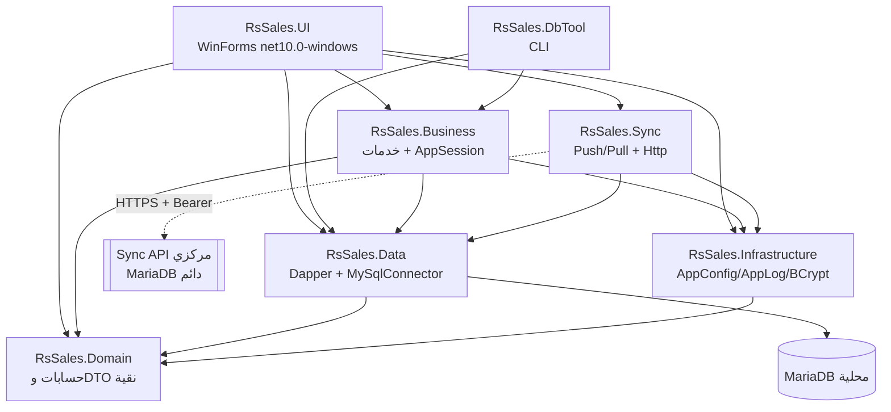
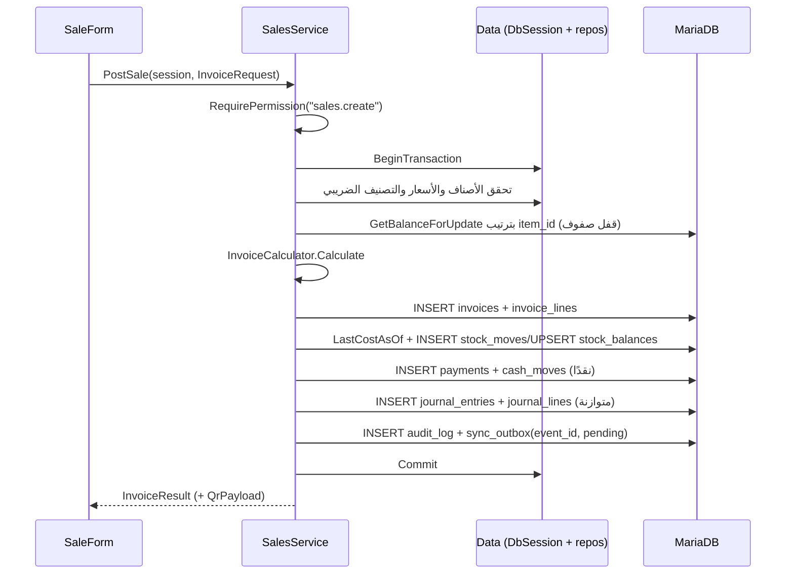
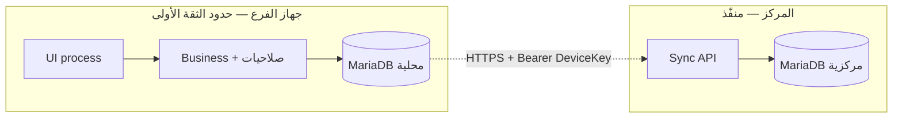

# المعمارية — RS Sales (VB.NET / Windows Forms)

**الحالة:** موثّقة **بأثر رجعي من الكود** — هذا الملف يصف ما هو منفّذ فعلًا في
`src/` وليس تصميمًا نظريًا. كل بند يفرّق صراحة بين **منفّذ** و**مخطط/ناقص**.
**آخر تحقق:** 2026-10-30 — HEAD يبني بنجاح (6 تحذيرات) و**36/36** اختبارًا تمر
على MariaDB حقيقية.
**المرجع الأعلى:** `PROJECT_STATUS.md` للحالة، و`docs/SYNC_PROTOCOL.md` لبروتوكول
المزامنة، و`BRANCH_MODEL_PROPOSAL.md` لنموذج الفروع.

---

## 1. القرارات الحاكمة

| # | القرار | الأثر المعماري |
|---|---|---|
| D-06 | بنية الحل: UI / Business / Data / Sync / Infrastructure / Tests | فصل صارم؛ `Domain` أُضيف كطبقة صفرية بلا I/O |
| D-09 | منع البيع بأكثر من الرصيد بلا استثناء، وفحص كل صنف حتى بلا صف رصيد | قفل صف الرصيد داخل معاملة البيع |
| D-10 | تكلفة البيع = آخر سعر شراء حتى تاريخ البيع (LASTCOST) + حفظ `cost_at_sale` | `StockRepository.LastCostAsOf` + عمود لقطة في `invoice_lines` |
| D-11 | نموذج «محلي أولًا + مركز تجميعي» بطبقتين A/B | كل فرع قاعدة كاملة + outbox/inbox؛ خادم مركز دائم (MariaDB) يستقبل الأحداث وينشر تغييرات الأساسيات |
| D-12 | الضريبة مفعّلة: 14% افتراضي، أسعار شاملة، QR | `tax_categories` + لقطات ضريبية في البند + `InvoiceCalculator` |
| — | .NET 10 (net10.0 / net10.0-windows) | SDK 10.0.403 مثبّت محليًا في `D:\dotnet` (خارج PATH) |
| — | VB.NET مع `Option Strict On` + `Option Explicit On` | مفروض في `Directory.Build.props` لكل المشاريع |
| — | كل المال `Decimal` وكل الأوقات UTC في `DATETIME(6)` | لا `float`/`double` في المخطط أو الكود |

---

## 2. نظرة عامة على الحل

الحل: `RsSales.slnx` — 7 مشاريع إنتاجية + مشروع اختبارات.

| المشروع | سطور | ملفات | يعتمد على | حِزم |
|---|---:|---:|---|---|
| `RsSales.Domain` | 381 | 6 | لا شيء | لا شيء |
| `RsSales.Data` | 1,700 | 14 | Domain | Dapper 2.1.89, MySqlConnector 2.6.2 |
| `RsSales.Business` | 1,852 | 10 | Domain, Data, Infrastructure | — |
| `RsSales.Sync` | 309 | 3 | Domain, Data, Infrastructure | — |
| `RsSales.Infrastructure` | 128 | 1 | Domain | BCrypt.Net-Next 4.2.0 |
| `RsSales.UI` | 3,554 | 18 | Domain, Data, Business, Sync, Infrastructure | QRCoder 1.6.0 |
| `RsSales.DbTool` | 635 | 1 | Domain, Data, Business, Infrastructure | — |
| `tests/RsSales.Tests` | 924 | 4 | Domain, Business, Data, Sync | xunit, Microsoft.NET.Test.Sdk |

**الإجمالي:** ≈8,559 سطر كود إنتاجي + 924 سطر اختبار.

---

## 3. مخطط الاعتماديات

**قواعد الاتجاه:** لا تستورد طبقة أدنى طبقة أعلى أبدًا. `Domain` لا يعرف
`MySqlConnector` ولا `WinForms`. `Data` لا يحتوي قواعد عمل. `UI` لا يكتب SQL.

---

## 4. الطبقات ومسؤولياتها

### 4.1 `RsSales.Domain` — الحساب النقي

| النوع | المسؤولية |
|---|---|
| `Money` | `Round2` (مقياس 2) و`Round4` (كميات) بسلوك `MidpointRounding.AwayFromZero` — كل تقريب مالي يمرّ من هنا |
| `TaxCalculator` | حساب بند واحد في الوضعين `inclusive`/`exclusive`، تحقق من معدل 0–100، وبناء حمولة QR بوسوم ETA الخمسة (Base64/TLV) |
| `DiscountAllocator` | توزيع الخصم على مستوى الفاتورة على البنود بطريقة «أكبر باقٍ» بحيث يكون مجموع الحصص = الخصم بالضبط |
| `InvoiceCalculator` | تجميع البنود: `Subtotal`, `LineDiscount`, `HeaderDiscount`, `TaxBaseTotal`, `TaxTotal`, `Total` — يرفض فاتورة فارغة وخصمًا على المرتجعات |
| `Uuid7` | توليد معرّفات الحدث (`event_id`) قابلة للفرز زمنيًا |
| `Models` | DTOs للطلبات/النتائج (`InvoiceRequest`, `InvoiceResult`, `StockSummary`, …) |

نقاء هذه الطبقة هو ما يجعل 17 اختبارًا وحدة ممكنًا بلا قاعدة بيانات.

### 4.2 `RsSales.Data` — الوصول للبيانات

- **`DbSession`** وحدة العمل: اتصال `MySqlConnector` + معاملة اختيارية
  (`ReadCommitted`) + `Dispose` يتراجع دائمًا إن لم يقع `Commit`. يفرض
  `DefaultTypeMap.MatchNamesWithUnderscores = True` و`GuidFormat=None`
  (لأن المخطط يخزّن `uuid`/`event_id` كنص).
- **المستودعات:** `Items`, `Invoices`, `Stock`, `Customers`, `Branches`,
  `Tax`, `Users`, `Accounting`, `Reports`, `Sequences`, `SyncStore`.
  كل الاستعلامات **مُعاملة (parameterized)**؛ لم يُرصد أي دمج نصي لمدخلات.
- **`SchemaMigrator`:** يطبّق `db/migrations/V*__*.sql` بالترتيب، يحسب
  SHA-256 لكل ملف ويرفض تعديل هجرة مُطبَّقة، ويقسّم السكربتات على `;` مع
  احترام النصوص والتعليقات، ويدعم `db/rollback/R*__*.sql`.
- **`SyncStore`:** outbox/inbox/cursors/change_log — تفاصيله في
  `SYNC_PROTOCOL.md`.
- **`Records`:** أنواع صفوف مطابقة للجداول.

### 4.3 `RsSales.Business` — قواعد العمل

`AppSession` هو سياق العملية: `ConnectionString`, `UserId`, `BranchId`,
`DeviceId`, `PricesIncludeTax`, `TaxEnabled`, و`Permissions`. التحقق من
الصلاحية يقع **في طبقة الأعمال** عبر `RequirePermission`، لا في الواجهة.

| الخدمة | العمليات العامة |
|---|---|
| `AuthService` | `Login` (قفل بعد محاولات فاشلة، تسجيل تدقيق)، `ChangePassword`, `CreateInitialAdmin` |
| `SalesService` | `PostSale`, `PostSaleReturn`, `GetInvoice`, `ListInvoices` |
| `PurchaseService` | `PostPurchase`, `PostPurchaseReturn`, `PostOpeningStock` |
| `StockService` | `Levels`, `Adjust`, `CreateTransfer`, `SendTransfer`, `ReceiveTransfer`, `ListTransfers` |
| `ItemService` | `Search`, `GetById`, `FindForSale` (كود/باركود)، `Save`, `SetActive` |
| `CustomerService` | `Search`, `GetById`, `Save`, `Balance` + **عمليات الوردية** (`Current`, `Open`, `Close`) |
| `TaxService` | `ListCategories`, `SaveCategory`, `EnsureDefaultCategories`, `GetSetting`, `SetSetting` |
| `ReportService` | `SalesByDay`, `Profit`, `TaxReport`, `StockValue`, `TopItems`, `CashSummary`, `CustomerDebt`, `TrialBalance` |
| `PostingHelper` | مساعدات الترحيل: `AsUtc`, `LocalBusinessDate`, `NextDocumentNo`, `BuildQr`, `DefaultPaymentMethod`, `IsCashMethod`, `CashboxOrThrow`, `Serialize` |

**نمط الترحيل الواحد (منفّذ):** كل عملية مالّية تفتح **معاملة واحدة** تكتب:
الفاتورة + بنودها + حركات المخزون + الدفعة/الحركة النقدية + القيد المحاسبي
+ سجل التدقيق + حدث الـ outbox، ثم `Commit`. أي استثناء ⇒ تراجع كلي
(لا توجد كتابة جزئية).

**ملاحظة تنظيمية:** عمليات الوردية داخل `CustomerService.vb` وقراءة
الإعدادات داخل `TaxService.vb` — تجميع غير مثالي يُنصح بفصله إلى
`ShiftService` و`SettingsService` لاحقًا (دين تقني لا خطأ وظيفي).

### 4.4 `RsSales.Sync` — عميل المزامنة

| النوع | المسؤولية |
|---|---|
| `SyncContracts` | عقد السلك: `SyncEvent`, `SyncBatch`, `SyncEventAck`, `SyncAck`, `PullChange`, `PullResponse`, `SyncRunResult`, وواجهة `ISyncTransport` |
| `SyncService` | `PushOnce`, `PullOnce`, `Status` — استخراج دفعة، تأكيد/فشل لكل حدث، backoff، إعادة الصفوف العالقة |
| `HttpSyncTransport` | `POST {ServerUrl}/api/v1/sync/push` و`GET .../pull` بـ `Bearer` ومهلة 30 ثانية |

الواجهة البرمجية الوسطى `ISyncTransport` تُبقي اختبارات المزامنة تعمل بلا
خادم (بديل وهمي)، والخادم المركزي منفّذ في `RsSales.Server` بمخزن MariaDB
دائم: `server_sync_events` لمفتاح `event_id` و`server_change_log` لتيار السحب.

### 4.5 `RsSales.Infrastructure`

- **`AppConfig.Load`** بترتيب حل: ملف JSON ⟶ ثم متغيرات البيئة
  (`RSSALES_CONNECTION`, `RSSALES_SERVER_URL`) لها الأولوية ⟶ ثم قيم
  افتراضية (`Server=localhost;Database=rs_sales;User ID=root;Password=;`).
- **`AppLog`** مسجّل ملفات يومي متزامن (thread-safe) لا يرمي استثناءً أبدًا
  («التسجيل لا يجوز أن يُفشل عملية بيع»).
- **`PasswordHasher`** BCrypt بعامل 11 + سياسة قوة كلمة المرور (8 أحرف،
  حرف ورقم على الأقل).

### 4.6 `RsSales.UI` — Windows Forms

18 ملفًا تضم **24 نموذجًا** (`Inherits Form`) ومساعدات. الواجهة عربية RTL
بالكامل، والأنماط مركزية في `UiTheme`/`UiLookup`.

| النموذج | الوظيفة |
|---|---|
| `LoginForm` | دخول + اختيار فرع (النسخة الملتزمة) |
| `MainForm` | لوحة معلومات (4 مؤشرات تتحدّث كل 60 ثانية) + قوائم + اختصارات F2/F3/F4 |
| `SaleForm` | نقطة البيع: مسح/بحث، سلة، خصم، دفع، QR، طباعة |
| `PurchaseForm`, `OpeningStockForm` | الشراء والمخزون الأول |
| `ItemsForm`, `StockForm`, `TransferForm` | الأصناف والباركود، الأرصدة، التحويل بين الفروع |
| `CustomersForm` | العملاء والموردون (نموذجان) |
| `ReportsForm`, `TaxForm`, `ShiftForm` | تقارير، ضريبة، وردية وصندوق |
| `SettingsForm`, `SyncForm` | إعدادات، حالة المزامنة وتشغيلها يدويًا |
| `PickAndResultForms` | نافذتا اختيار ونتيجة + تغيير كلمة المرور |

**قيد معماري قائم:** كل استدعاءات قاعدة البيانات **متزامنة على خيط الواجهة**
(بدءًا من تحديث لوحة المعلومات كل دقيقة). أي بطء شبكة/قاعدة ⇒ تجمّد مؤقت
للنموذج. الحل المخطط: نقل التحديثات إلى `Task`/خيط خلفي مع `Invoke`.

### 4.7 `RsSales.DbTool` — أداة CLI

`migrate`, `rollback`, `seed`, `create-admin`, `import-legacy`, `verify`,
`status` — مع دعم `--conn` أو `RSSALES_CONNECTION`، وطباعة تشخيصات مفصّلة عند
`RSSALES_DEBUG=1`. الأداة هي مصدر إنشاء القاعدة وتعبئتها بالبيانات المرجعية.

---

## 5. تدفق عملية البيع (المرجع)

**قواعد لا تُخرَق (منفّذة ومُختبَرة):** الكمية > 0؛ الرصيد كافٍ وإلا رُفض
البيع دون أي أثر؛ سعر أقل من الحد الأدنى يتطلب `sales.below_min_price`؛
خصم الفاتورة يتطلب `sales.discount`؛ خصم البند لا يتجاوز قيمته؛ `Paid`
لا يتجاوز الإجمالي؛ كل قيد محاسبي متوازن؛ المرتجع لا يتجاوز المتاح من
الفاتورة الأصلية ويرتبط بـ`original_line_id`.

---

## 6. حدود الثقة والأمان

**منفّذ:** BCrypt للكلمات، قفل مؤقت بعد محاولات فاشلة، تدقيق كل عملية
حساسة (`audit_log`)، صلاحيات دقيقة في طبقة الأعمال، والتحقق من أن المستخدم
مُسنَد إلى الفرع المطلوب.

**أُصلح في 2026-10-30:** أُلغي الدخول التلقائي (S-1)، وأُزيلت كلمة المرور
المسبقة/الافتراضية، وأصبح `seed` يرفض إنشاء أول مدير بلا كلمة مرور قوية (S-2).

**ناقص أو ضعيف (يجب معالجته قبل الإنتاج):**

| # | الثغرة | الأثر |
|---|---|---|
| S-7 | لا HMAC/توقيع/طابع زمني/حد معدل على طلبات المزامنة | إعادة إرسال أو تزوير محتمل من عميل مخترق |
| S-8 | الصلاحيات تُفرض داخل العملية نفسها؛ من يملك وصول SQL يتجاوزها | حدّ ثقة محلي لا يُغني عن حساب قاعدة مقيّد |

**أُصلحت سابقًا:** S-3 (حساب قاعدة مخصص بلا `root`)، S-4 (فرض HTTPS خارج
localhost)، S-5 (DPAPI لبيانات الدخول/التوكن)، S-6 (فرض صلاحيات التقارير).

---

## 7. قاعدة البيانات

**المخطط:** `db/migrations/V001__init.sql` — **45 جدولًا**، **60 مفتاحًا
أجنبيًا**، View واحد (`v_stock`)، InnoDB + `utf8mb4_unicode_ci`، و**صفر**
حقول `float`/`double`.

| المجموعة | الجداول |
|---|---|
| الهوية والإعداد | `branches`, `settings`, `branch_settings`, `roles`, `permissions`, `role_permissions`, `users`, `user_roles`, `user_branch_access`, `devices`, `document_sequences` |
| الضريبة والأصناف | `tax_categories`, `item_groups`, `units`, `items`, `item_barcodes`, `item_units`, `item_price_history` |
| الأطراف | `customers`, `payment_methods`, `cashboxes` |
| الورديات والمخزون | `shifts`, `cash_moves`, `stock_moves`, `stock_balances`, `stock_transfers`, `stock_transfer_lines`, `inventory_counts`, `inventory_count_lines` |
| البيع والشراء | `invoices`, `invoice_lines`, `payments` |
| المحاسبة | `accounts`, `journal_entries`, `journal_lines` |
| الولاء | `loyalty_accounts`, `loyalty_transactions`, `coupons`, `coupon_redemptions` |
| التشغيل والمزامنة | `audit_log`, `sync_outbox`, `sync_inbox`, `sync_cursors`, `change_log`, `schema_migrations` |

**مبادئ التصميم المنفّذة:**

1. `stock_moves` هو **مصدر الحقيقة** للمخزون؛ `stock_balances` مخزن مؤقت
   يُحدَّث في نفس معاملة الحركة، وقابل لإعادة الحساب (`RecomputeBalance`).
2. **الفاتورة المرحّلة غير قابلة للتعديل**؛ التصحيح بوثيقة جديدة
   (مرتجع/إلغاء) — `InvoicesRepository.Void` يضبط الحالة فقط.
3. `event_id` (UUIDv7) على كل صف تشغيلي قابل للمزامنة، و`branch_id` على كل
   جدول تشغيلي.
4. الأرقام المستندية تُولَّد محليًا من `document_sequences` لكل فرع/نوع/سنة —
   المركز لا يصدر أرقامًا تشغيلية (يمنع التصادم عند الانقطاع).
5. اللقطات الضريبية محفوظة في البند (`tax_rate`, `tax_base`, `tax_amount`,
   `price_mode`) و`cost_at_sale` / `cost_at_sale_incl_tax` — التقارير التاريخية
   لا تتأثر بتغيّر الإعدادات لاحقًا.
6. جداول **الولاء والكوبونات والجرد (`inventory_counts`) موجودة في المخطط
   بلا كود تطبيقي بعد**.

---

## 8. الضريبة

- الأسعار **شاملة الضريبة** افتراضيًا (`tax.prices_include_tax=1`)، والوضع
  يُحفظ لكل فاتورة في `price_mode`.
- الخصم (بندًا أو فاتورة) يُطبَّق **قبل** استخراج الضريبة، والتوزيع على
  البنود بطريقة أكبر باقٍ لتفادي فروق التقريب.
- QR يُبنى بوسوم ETA الخمسة (اسم البائع، الرقم الضريبي، الطابع الزمني،
  الإجمالي، الضريبة) عبر `TaxCalculator.BuildQrPayload`، ويُخزَّن في
  `invoices.qr_payload`.
- تقرير الضريبة يجمع المخرجات (بيع/مرتجع) والمدخلات (شراء/مرتجع) حسب المعدل،
  ويعرض `LedgerTaxMovement` من حساب ضريبة المخرجات للمطابقة — الاختبارات
  تتحقق من تطابق الرقمين. **تكامل ETA مؤجَّل بقرار D-12.**

---

## 9. الطوبولوجيا والتزامن

النموذج المعتمد (D-11): **محلي أولًا + مركز تجميعي** بمستويين A (جهاز واحد)
و B (خادم فرع صغير). كل فرع يعمل بقاعدة محلية كاملة بلا اعتماد على المركز في
البيع؛ والمركز يجمع الأحداث. التفاصيل الكاملة والرسائل والتعارضات في
`docs/SYNC_PROTOCOL.md`.

---

## 10. سيناريوهات الفشل والسلوك الفعلي

| الفشل | السلوك المنفّذ | الملاحظة |
|---|---|---|
| تعذّر الاتصال بقاعدة الفرع | استثناء ⇒ رسالة عربية في الواجهة + `AppLog` | البيع مستحيل بلا قاعدة — الاعتماد مقصود |
| انقطاع الإنترنت | البيع يستمر؛ الحدث يبقى `pending/failed` مع backoff | شاشة المزامنة تُظهر العدّادات |
| استثناء وسط الترحيل | `DbSession.Dispose` يتراجع عن كل الكتابات | لا فاتورة ناقصة |
| تعطّل العملية والحدث في `sending` | `RequeueStuck` يعيده `failed` بعد مهلة | المهلة محسوبة من `occurred_at` لا من لحظة المطالبة |
| إعادة إرسال نفس الحدث | `sync_inbox` مفتاح أساسي ⇒ `duplicate` بلا أثر | مُختبَر |
| فشل الخادم المتكرر | 10s → 20s → … بحد 3600s، ثم `dead` | لا إسقاط صامت أبدًا |
| ساعة جهاز منحرفة | **غير معالَج** — لا تحقق انحراف | مطلوب في `SYNC_PROTOCOL` §10 |
| تلف قرص الفرع | **غير معالَج** — لا استرجاع آلي من لقطة | مرحلة 7 |
| ملف إعدادات تالف | `Program` يعرض خطأ ويكمل بإعدادات افتراضية | يخفي التعطل الجزئي |

---

## 11. التشغيل والبناء

| العنصر | القيمة المتحقَّقة |
|---|---|
| نظام التطوير | Windows 10 Pro 19045 |
| SDK | .NET **10.0.403** مثبّت محليًا في `D:\dotnet` (غير مضاف إلى PATH) |
| قاعدة البيانات | MariaDB 13.0.2 على `127.0.0.1:3306` |
| بناء الحل | `D:\dotnet\dotnet.exe build RsSales.slnx` |
| تشغيل الواجهة | `dotnet run --project src/RsSales.UI` |
| أدوات القاعدة | `dotnet run --project src/RsSales.DbTool -- migrate|seed|verify` |
| الاختبارات | `dotnet test tests/RsSales.Tests` (RSSALES_TEST_SERVER اختياري) |

الاختبارات تُسقط قاعدة `rs_sales_test_it` وتُنشئها من جديد في بداية كل تشغيل،
وتطبّق **الهجرات الحقيقية** ثم تزرع بيانات مرجعية (فرع MAIN + تصنيفان ضريبيان + 13 حسابًا + مستخدم
`tester` بكل الصلاحيات). لذلك لا يلمس الاختبار الإنتاج ولا قاعدة التطبيق.

---

## 12. استراتيجية الاختبار

| النوع | العدد | الملف | يغطي |
|---|---:|---|---|
| وحدة (بلا قاعدة) | 17 | `DomainTests.vb` | الضريبة (شامل/غير شامل/صفر)، الخصم والتوزيع، التقريب، UUIDv7، QR |
| تكامل (MariaDB) | 39 | `IntegrationTests.vb`, `HrIntegrationTests.vb`, `SecurityAndInventoryTests.vb`, `SyncServerStoreTests.vb` | البيع/المرتجع/الشراء/المخزون الأول/التسوية/التحويل، توازن القيود، الصلاحيات، الدخول والقفل، outbox/inbox، دفع المزامنة وفشلها، تطبيق Pull والحذف والرفض، ومخزن الخادم |

**فجوات الاختبار المعروفة:** لا اختبارات واجهة، لا اختبار تزامن (بيعان
متوازيان على آخر قطعة)، لا اختبار `db:rollback`، لا اختبار تعارض بين فرعين،
ولا اختبار طباعة/مسح باركود، ولا اختبار HTTP فعلي بين عميل وخادم.

---

## 13. الديون المعمارية المفتوحة

| # | الدين | الخطورة |
|---|---|---|
| A-1 | أحداث الفواتير/المخزون تُخزَّن في المركز ولا تُبنى منها صورة مجمّعة بعد | 🟠 يقيّد تقارير المركز |
| A-3 | أسرار افتراضية/ضعيفة في القوالب (S-7/S-8 أعلاه) | 🔴 قبل الإنتاج |
| A-4 | كل DB على خيط الواجهة | 🟠 أداء |
| A-5 | `change_log` المحلي لا يُرسل كتيار مستقل؛ الأصناف/العملاء تُرسل كأحداث outbox | 🟡 تصميم |
| A-6 | التوكن مشترك بين الأجهزة ولا يوجد هاش/إبطال لكل جهاز | 🟠 أمني |
| A-7 | `ReportService` بلا فرض صلاحيات | 🟠 أمني |
| A-8 | عمليات الوردية/الإعدادات في خدمات غير مخصصة لها | 🟡 تنظيمي |
| A-9 | وثائق المرحلة 2 مكتملة، لكن بوابة "مراجعة المالك للتصميم" لم تُوقَّع بعد | 🟡 حوكمة |
| A-10 | لا CI ولا `.editorconfig` ولا مثبّت | 🟡 تسليم |

---

## 14. المراجع

- `PROJECT_STATUS.md` — الحالة الحالية والقرارات والمعوّقات.
- `docs/SYNC_PROTOCOL.md` — البروتوكول الفعلي بين الفرع والمركز.
- `docs/BRANCH_MODEL_PROPOSAL.md` — نموذج الفروع وملكية البيانات واختبارات القبول.
- `docs/TAX_DESIGN.md` — تصميم الضريبة.
- `docs/DATA_MIGRATION_PLAN.md` — نقل البيانات من النظام القديم وحوكمة القطع.
- `docs/ERD.md` — مخططات الكيانات والعلاقات للجداول الـ45.
- `docs/PHASE_2_REPORT.md` — تقرير المرحلة 2 وبوابتها.
- `docs/DATABASE_SCHEMA.md` — مخطط النظام **القديم** (مرجع ترحيل، ليس مخططًا جديدًا).
- `db/migrations/V001__init.sql` — المخطط المنفّذ فعليًا.
