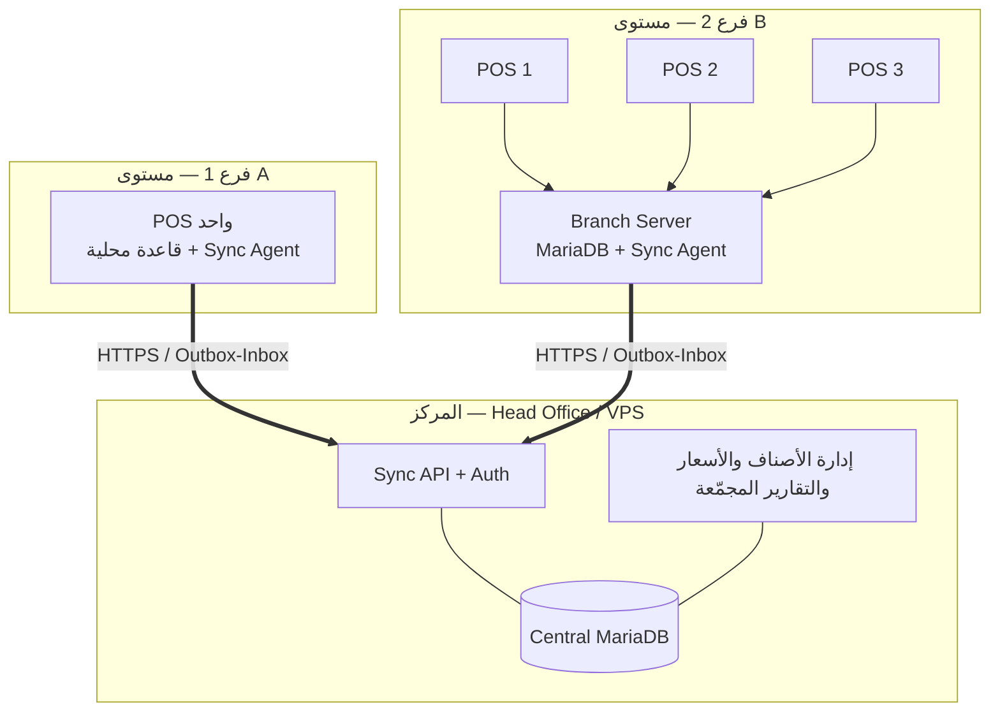

# مقترح نموذج الفروع — Q-13

**الحالة:** مقترح للاعتماد — **ليس بداية المرحلة 2**.
**التاريخ:** 2026-10-28
**السؤال:** كيف ننفّذ «عدة فروع + عمل دون إنترنت + مزامنة مركزية» دون تعقيد زائد؟

---

## 1. القرار الموصى به

**نموذج «محلي أولًا + مركز تجميعي» (Offline-first Hub & Spoke) بطبقتين:**

- **كل فرع** يملك قاعدة MariaDB محلية كاملة لبياناته التشغيلية، ويعمل بها
  حتى لو انقطع الإنترنت تمامًا.
- **مركز واحد** (خادم الشركة أو VPS) يملك قاعدة مجمّعة + API مزامنة +
  إدارة الأصناف والأسعار والمستخدمين والتقارير المجمّعة.
- **المزامنة حدثية (Event-based)** عبر `outbox/inbox` و`event_id`، لا
  `REPLACE` ولا `last-write-wins` للمالي.
- **مستويان للنشر** بنفس المخطط والكود:
  - **مستوى A — فرع بجهاز واحد:** الجهاز نفسه يستضيف قاعدة الفرع + وكيل
    المزامنة. مناسب لأغلب الفروع.
  - **مستوى B — فرع بعدة أجهزة:** جهاز خادم فرع صغير (Mini-PC) يستضيف
    القاعدة، وأجهزة الكاشير تتصل به عبر الشبكة المحلية.

> هذا هو الخيار (أ) في `RISKS_AND_QUESTIONS.md`، مع تفصيل التنفيذ الذي
> كان ناقصًا. الخيار (ب) «مركزي فقط» مرفوض لأنه يناقض شرط العمل دون إنترنت.
> الخيار (ج) «هجين» ليس بديلًا مستقلًا؛ هو وصف لهذا النموذج نفسه.

---

## 2. الطوبولوجيا



**قاعدة ذهبية:** جهاز الكاشير لا يتصل بالمركز مباشرة في مستوى B؛ يتصل
بخادم الفرع. المركز يتحدث مع **عقدة فرع واحدة** فقط.

---

## 3. لماذا هذا النموذج

| المتطلب | كيف يُحقق |
|---|---|
| البيع يعمل بلا إنترنت | قاعدة الفرع محلية؛ لا اعتماد على المركز في البيع |
| تقارير مجمّعة لكل الفروع | المركز يجمع الأحداث ويبني الأرصدة والتقارير |
| عدم تصادم أرقام الفواتير | كل فرع يملك مسلسله الخاص |
| عدم فقدان فاتورة | Outbox دائم + إعادة محاولة + ACK قبل الحذف |
| عدم تضاعف فاتورة | `event_id` مفتاح أساسي في `sync_inbox` |
| تحويل مخزون بين الفروع | وثيقة تحويل بحالتين + حركتان |
| إضافة فرع جديد بسهولة | تفريغ لقطة من المركز + بدء مسلسل مستقل |
| تكلفة تشغيل معقولة | جهاز واحد لكل فرع صغير؛ لا بنية سحابية معقدة |

---

## 4. ملكية البيانات (من يكتب ماذا)

| البيانات | مصدر الحقيقة | الاتجاه | ملاحظات |
|---|---|---|---|
| الفروع، المستخدمون، الأدوار، الصلاحيات | المركز | ↓ للمركز → الفرع | الفرع لا ينشئ مستخدمًا بصلاحية مدير |
| الأصناف، المجموعات، الوحدات، الباركود | المركز | ↓ | تعديل الفرع ممنوع افتراضيًا |
| الأسعار، نسبة الضريبة، التصنيف الضريبي | المركز | ↓ | يمكن السماح بتجاوز محلي محدود (Q-15) |
| العملاء والموردون | الفرع ينشئ، المركز يدمج | ↑ ثم ↓ | `uuid` يمنع التصادم؛ الدمج يدوي عند التكرار |
| فواتير البيع/الشراء/المرتجعات | الفرع | ↑ | غير قابلة للتعديل بعد الترحيل |
| المدفوعات والحركات النقدية | الفرع | ↑ | مرتبطة بالوردية |
| حركات المخزون | الفرع (لحركاته) | ↑ | المركز يبني الرصيد المجمّع |
| أرصدة المخزون | الفرع لرصيده، المركز للمجمّع | ↓ لقطة + ↑ أحداث | `stock_balances` Cache |
| التحويلات بين الفروع | الطرفان | ↑↓ | مرحلتان: أُرسل / استُلم |
| الورديات والجرد | الفرع | ↑ | الإقفال يمنع التعديل محليًا |
| الإعدادات | المركز افتراضيًا | ↓ | تجاوزات فرعية محددة فقط |
| سجل التدقيق | الطرفان | ↑ | لا يُحذف |

**كل صف تشغيلي يحمل `branch_id` و`uuid`.** المركز لا يكتب فاتورة نيابة
عن فرع؛ بل يستقبلها كحدث.

---

## 5. دورة حياة الفاتورة دون إنترنت

1. الكاشير يحفظ الفاتورة → كتابة محلية في معاملة واحدة:
   `invoices` + `invoice_lines` + `stock_moves` + `payments` +
   `sync_outbox(event_type='invoice.posted')` + تدقيق.
2. الواجهة تعرض «محفوظة محليًا — بانتظار المزامنة» مع رقم الفاتورة.
3. وكيل المزامنة (خدمة Windows) يرسل الدفعة عند توفر الشبكة.
4. المركز يتحقق من الصلاحية والـidempotency ويطبّق الحدث في معاملة،
   ثم يعيد ACK لكل حدث.
5. الفرع يعلّم الحدث `acked` ويحتفظ به مدة (30 يومًا) قبل الأرشفة.
6. عند الفشل: يبقى `pending` ويعاد بتباعد متدرج. لا حذف قبل ACK.

**الطباعة لا تنتظر المزامنة.** رقم الفاتورة يُحجز محليًا قبل الطباعة.

---

## 6. بروتوكول المزامنة (الحد الأدنى الملزم)

### 6.1 ظرف الحدث

```json
{
  "event_id": "0199f3a2-7c41-7c3a-9d5e-1a2b3c4d5e6f",
  "schema_version": 1,
  "branch_id": 3,
  "device_id": 12,
  "entity_type": "invoice",
  "entity_id": "0199f3a2-...",
  "event_type": "invoice.posted",
  "aggregate_version": 1,
  "occurred_at": "2026-10-28T10:15:30Z",
  "business_date": "2026-10-28",
  "payload": { "...": "الحالة الكاملة" },
  "payload_sha256": "...",
  "prev_event_id": null
}
```

### 6.2 المسارَان

| المسار | المحتوى | التكرار |
|---|---|---|
| **Up** `POST /sync/push` | دفعة من `sync_outbox` (حد أقصى 200 حدث أو 1 MB) | كل 60 ثانية، وفورًا عند توفر الشبكة |
| **Down** `GET /sync/pull?cursor=` | تغييرات الأساسيات + أوامر إدارية + إقرارات التحويلات | كل 5 دقائق، وعند بدء التشغيل |

- المركز يحتفظ بـ`change_log(seq, entity_type, entity_id, op, payload, changed_at)`.
- كل فرع يحتفظ بـ`sync_cursors(stream, last_seq)`.
- **الترتيب مضمون لكل كيان على حدة** (`aggregate_version`)، وليس عالميًا.

### 6.3 الثبات والتكرار

- `sync_inbox.event_id` مفتاح أساسي → التكرار يعيد `duplicate` ولا يطبّق.
- `sync_outbox` لا يُحذف قبل ACK.
- التطبيق في المركز داخل معاملة واحدة للحدث.
- الدفعة ليست ذرّية بالكامل: كل حدث له نتيجة مستقلة حتى لا يعيد فرع
  إرسال ما نجح.

### 6.4 إعادة المحاولة

`5s → 15s → 1m → 5m → 15m → 1h` مع jitter، ثم `dead` مع تنبيه في
شاشة «حالة المزامنة» وإمكانية إعادة يدوية. لا إسقاط صامت.

### 6.5 الأمان

- TLS 1.2+ إلزامي، وشهادة صالحة (لا تجاوز تحقق).
- توكن لكل جهاز/عقدة فرع، مخزّن مُهشَّرًا في المركز، وقابلًا للإبطال.
- توقيع HMAC للطلب + طابع زمني + nonce لمنع الإعادة.
- حد معدل لكل فرع، وسجل محاولات مرفوضة.
- لا أسرار في المستودع أو السجلات (DPAPI على جهاز الفرع).

### 6.6 الساعة

- UTC في `occurred_at`، و`business_date` بتوقيت الفرع.
- رفض/تحذير عند انحراف > 10 دقائق؛ شاشة تشخيص تعرض الانحراف.

---

## 7. الترقيم

- `document_sequences(branch_id, doc_type, period, next_no)`.
- رقم الفاتورة: `branch_code + doc_type + YYYY + 6 أرقام` (أو رقم متسلسل
  لكل فرع/نوع/سنة — القرار DB-03).
- **المركز لا يصدر أرقامًا تشغيلية للفروع.** هذا يمنع التصادم عند الانقطاع.
- عند استرجاع فرع من لقطة مركزية: يُستأنف المسلسل من آخر رقم معروف.

---

## 8. التعارضات — قواعد الحسم

| الحالة | الحسم |
|---|---|
| نفس الفاتورة تصل مرتين | `duplicate` بلا أثر |
| تعديل فاتورة مُرحَّلة | مرفوض؛ يُنشأ مرتجع/إلغاء (قيد عكسي) |
| فرعان يعدّلان نفس الصنف | المركز يفوز؛ تعديل الفرع يتحول إلى «طلب تغيير» أو تجاوز محلي بتاريخ انتهاء |
| سعر تغيّر والفرع offline | الفرع يستخدم آخر سعر معروف؛ تحذير إذا تجاوزت بيانات الأساسيات 7 أيام |
| عميل أُنشئ مرتين offline | يُحتفظ بالـUUIDين؛ أداة دمج يدوية (جوال/رقم قومي) |
| تحويل أُرسل ولم يُستلم | يظهر «في الطريق» ولا يُضاف لرصيد المستلم |
| وردية أُغلقت محليًا وتعديل لاحق | مرفوض؛ يتطلب صلاحية فتح استثنائي + تدقيق |
| تعارض مخزون (بيع سالب) | مرفوض في الفرع أصلًا (قرار Q-05) |

**مبدأ:** لا دمج حقول ماليًا. التصحيح دائمًا بوثيقة جديدة.

---

## 9. المخزون والتحويلات

- `stock_moves` هو مصدر الحقيقة؛ `stock_balances` Cache يُحدَّث في نفس المعاملة.
- البيع يخصم من رصيد الفرع فقط، والمركز يجمع كل الحركات.
- **التحويل**:
  1. الفرع المرسل ينشئ `transfer.sent` → `stock_moves` سالبة + «في الطريق».
  2. الفرع المستلم يؤكد `transfer.received` → `stock_moves` موجبة.
  3. رفض/إلغاء بعد الإرسال → حركة عكسية + سبب.
- لا يُسمح باستلام كمية أكبر من المرسلة.
- تقرير «تحويلات معلّقة» يومي.

---

## 10. الفشل والاسترجاع

| الفشل | السلوك |
|---|---|
| انقطاع الإنترنت | البيع يستمر؛ عدّاد «غير مُزامن» ظاهر |
| تعطّل المركز | البيع يستمر؛ المزامنة تتوقف ولا تُفقد الأحداث |
| تعطّل خادم الفرع (مستوى B) | الكاشير يتوقف — يلزم UPS + قرص احتياطي + جهاز بديل |
| تلف قرص الفرع | استرجاع من آخر لقطة مركزية + إعادة تشغيل الأحداث غير المؤكدة |
| إعادة تثبيت جهاز | لقطة كاملة من المركز + استئناف المسلسل |
| ساعة خاطئة | منع المزامنة + تنبيه |
| حدث تالف (payload hash) | `rejected` + تنبيه؛ لا تطبيق جزئي |

**النسخ الاحتياطي:** لقطة يومية للمركز + سجل أحداث، ولقطة أسبوعية لكل فرع
مع اختبار استرجاع شهري.

---

## 11. الأحجام والتقديرات

- 29,595 صنفًا + 29,576 باركودًا: لقطة أساسيات صغيرة (< 30 MB مضغوطة).
- فرع متوسط: 1,000–3,000 فاتورة/يوم، 10 بنود للفاتورة → 10–30 ألف صف
  مخزون/يوم. MariaDB محلية تتحمل ذلك بسهولة.
- حجم الأحداث: 2–5 KB للفاتورة → 5–15 MB/يوم/فرع. يمكن الاحتفاظ
  90 يومًا في المركز ثم أرشفة.
- زمن مزامنة 1,000 فاتورة: ثوانٍ إلى دقائق حسب الشبكة.

---

## 12. ما يحتاجه هذا النموذج من المالك

| # | السؤال | التوصية |
|---|---|---|
| B-01 | أين المركز؟ خادم في المقر أم VPS؟ | VPS صغير + نسخ احتياطي يومي، أو المقر مع IP ثابت وVPN |
| B-02 | كم فرعًا الآن وكم بعد سنتين؟ | يؤكد افتراض 2–10 |
| B-03 | جودة الإنترنت في الفروع؟ | يحدد مهلة المزامنة وحدود الدفعات |
| B-04 | هل يوجد جهاز خادم/شبكة داخلية في كل فرع؟ | مستوى A أو B |
| B-05 | من يدير المستخدمين والأسعار؟ | المركز فقط (موصى به) |
| B-06 | هل يُسمح بتعديل سعر محلي؟ | لا افتراضيًا (Q-15) |
| B-07 | هل الفروع في نفس الدولة/التوقيت؟ | يثبت `business_date` |
| B-08 | هل يلزم وصول مالك واحد لكل الفروع من جهاز واحد؟ | نعم، عبر المركز |

---

## 13. اختبارات قبول النموذج

- [ ] بيع 100 فاتورة offline ثم عودة الشبكة → 100 حدث، صفر تكرار،
      مطابقة تامة لإجماليات المركز.
- [ ] قطع الشبكة أثناء دفعة → لا تطبيق جزئي، وإعادة المحاولة تكمل.
- [ ] إعادة إرسال نفس الحدث 10 مرات → أثر واحد.
- [ ] فرعان يبيعان نفس الصنف → رصيد المركز = مجموع الحركتين.
- [ ] تحويل مُرسل بلا استلام → لا يزيد رصيد المستلم.
- [ ] استرجاع فرع من لقطة → المسلسل يكمل بلا تصادم.
- [ ] ساعة فرع متقدمة ساعة → مزامنة مرفوضة/محذرة.
- [ ] مستخدم فرع لا يرى بيانات فرع آخر (اختبار عزل).
- [ ] إعادة تشغيل خادم الفرع → لا فاتورة مفقودة.

---

## 14. علاقة النموذج بالمراحل

| المرحلة | ما يُنجز |
|---|---|
| 2 | `ARCHITECTURE.md` + `SYNC_PROTOCOL.md` + مخطط `sync_outbox/inbox` و`document_sequences` |
| 3 | `branch_id` إلزامي في طبقة الوصول + `device_id` + التوكن |
| 4 | تشغيل فرع واحد كاملًا محليًا (بلا مزامنة) |
| 5 | المزامنة الفعلية + التحويلات + شاشة الحالة |
| 6 | تقارير مجمّعة + مطابقة |
| 7 | فرعان في تشغيل متوازٍ ثم التعميم |

**الاعتماد المطلوب:** «أوافق على النموذج والطبقتين A/B» + إجابات B-01…B-08.
