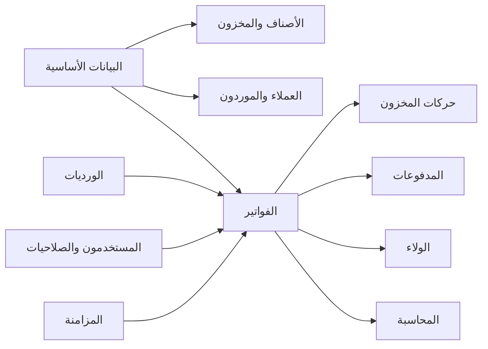
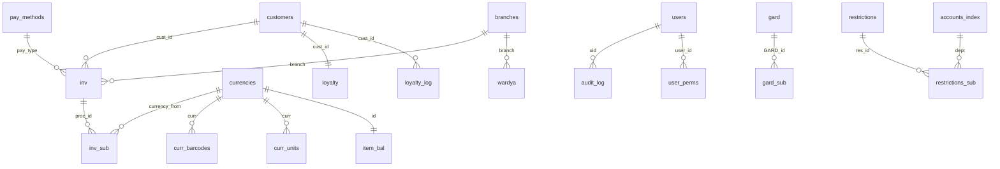

# مخطط قاعدة البيانات — Database Schema

**القاعدة الحالية:** `rs_pharmacy` (MariaDB 13.0.2)
**الحجم:** 68 جدولًا + 4 Views
**الترميز:** `utf8mb4` / `utf8mb4_unicode_ci`
**تاريخ اللقطة:** 2026-10-28

> المرجع الآلي الكامل: `docs/reference/schema_report.txt` (كل جدول وكل عمود
> وفهرس وعدد صفوف)، و`docs/reference/core_schema.txt` (SHOW CREATE TABLE)،
> و`docs/reference/views.sql`.

---

## 1. مبادئ القراءة

1. **لا Foreign Keys فعلية** في القاعدة الحالية. كل العلاقات أدناه منطقية
   مستخرجة من الكود، وليست مفروضة من المحرك.
2. **`inv` و`inv_sub` بلا Primary Key**. `inv.proc_id` فريد
   (`ux_inv_proc_id`)، و`inv_sub.id` فريد (`ux_sub_id`).
3. **`IS_Buy` + `proc_type`** هما نوع الفاتورة. دلالة `proc_type` في الرأس
   تختلف عن دلالته في البنود (انظر §4).
4. **المبالغ:** معظم حقول الرأس `DECIMAL(14,2)`، وأسعار البنود
   `DECIMAL(12,4)`. لكن حقولًا محاسبية تستخدم `double` — دين تقني.
5. **الحذف الناعم** شائع: `IS_Deleted` / `is_deleted` / `vaild`.
6. **`branch=99`** تعني «الفرع المحلي لهذه النسخة»، وكل ما عداه فواتير
   مستوردة للعرض.

---

## 2. خريطة النطاقات



| النطاق | الجداول |
|---|---|
| أساسيات | `branches`, `companies`, `countries`, `cities`, `areas`, `units`, `groups`, `departments`, `employees`, `salesmen`, `delivery_emps`, `pay_methods`, `stocks`, `safes`, `banks`, `tawla`, `tawla_groups` |
| الأصناف | `currencies`, `curr_barcodes`, `curr_units`, `curr_sup`, `eo_item_img` |
| المخزون | `item_bal`, `count_list`, `gard`, `gard_sub`, `twreed_srf`, `twreed_srf_sub`, `rs_count` |
| الفواتير | `inv`, `inv_sub` |
| العملاء | `customers`, `cust_groups`, `loyalty`, `loyalty_log`, `coboun`, `voucher`, `voucher_cust`, `voucher_cust_invs` |
| المحاسبة | `accounts_index`, `restrictions`, `restrictions_sub`, `rs_expenses`, `rs_safebox`, `salarypay` |
| المستخدمون | `users`, `user_perms`, `app_users`, `audit_log` |
| الإعدادات والترقيم | `app_settings`, `rs_seq`, `rs_sync`, `days` |
| المزامنة والجسور | `rs_sync`, `bridge_log`, `bridge_map`, `bridge_state`, `rs_eo_log`, `rs_eo_map` |
| جداول مساندة/قديمة | `sandd`, `sandq`, `sandqd`, `sandsd`, `currencies_group_bak_20261028`, `curr_barcodes_bak_20261028`, `_orphan_sub` |

---

## 3. الجداول الأساسية بالتفصيل

### 3.1 `inv` — رأس الفاتورة (0 صف)

| المجموعة | الأعمدة | ملاحظات |
|---|---|---|
| الهوية | `proc_id` (UNIQUE), `id`, `branch`, `proc_type`, `IS_Buy`, `IS_Temp`, `IS_Deleted`, `user_IS_Deleted` | `id` رقم المستند، `proc_id` مفتاح الربط بالبنود |
| الزمن | `date`, `IS_updated`, `user_IS_updated` | `date` هو تاريخ العملية |
| الطرف | `cust_id`, `salesman`, `sales_emp`, `emp`, `dlevman` | `cust_id` عميل/مورد |
| المبالغ | `tot_purch`, `tot_sale`, `tot_net`, `paid`, `minus`, `disc`, `cust_disc`, `custdiscadd`, `fees`, `tax`, `tax_ats`, `costadd` | كلها `DECIMAL(14,2)`؛ `tax`/`tax_ats` **نائمة وغير محسوبة** |
| الدفع | `pay_type`, `bank`, `bank2`, `cash_part`, `network_part`, `bank_part`, `emp_part`, `check_refno` | `pay_type` → `pay_methods.id` |
| التوصيل/الحجز | `delivery`, `reserv_*`, `date_delevGoes`, `date_delevCome`, `client_*`, `is_tfseel*` | أغلبها غير مستخدم في شاشة البيع الحالية |
| العروض | `coboun`, `coboun_id`, `coboun_Dis`, `offer_id`, `voucher_code`, `voucher_value` | كوبون/قسيمة |
| المحاسبة | `purch_rest_id`, `sale_rest_id`, `rest_type`, `safe`, `stock`, `center` | الحقول موجودة لكن **لا تُملأ** من حفظ الفاتورة |
| أخرى | `inv_type`, `notes`, `inv_notes`, `refno`, `mobapp_id`, `pc`, `persons`, `printed_recipt` | إرث أنظمة أخرى |

**الفهارس:** `ux_inv_proc_id(proc_id)` فريد، `ix_inv_branch_id(branch,id)`،
`ix_inv_branch_proc(branch,proc_id)`، `ix_inv_proc(proc_id)`، `ix_inv_id(id)`،
`ix_inv_dd(date)`، `ix_inv_cust(cust_id)`، `ix_inv_sm(salesman)`،
`ix_inv_tp(IS_Deleted,IS_Buy,proc_type)`.

### 3.2 `inv_sub` — بنود الفاتورة (0 صف)

| العمود | النوع | المعنى |
|---|---|---|
| `id` | INT UNIQUE | رقم البند |
| `proc_id` | INT | ربط بالرأس |
| `proc_type` | INT | **2 = بيع، 1 = شراء** (معاكس للرأس) |
| `currency_from` | INT | `currencies.id` |
| `unit` | INT | `units.id` (غالبًا غير مستخدم) |
| `i1`, `i2` | BIGINT | حقول إرث |
| `val`, `val1` | DECIMAL(12,4) | الكمية |
| `exchange_price` | DECIMAL(12,4) | السعر (بيع/شراء) |
| `sale_price` | DECIMAL(12,4) | سعر البيع وقت الشراء |
| `discount` | DECIMAL(14,2) | خصم البند |
| `taxperc`, `taxval` | DECIMAL | ضريبة **نائمة** (لا تُحسب ولا تُحفظ) |
| `expire_date` | DATETIME | الصلاحية |
| `notes`, `Txtr`, `invpurch`, `barcode` | TEXT | مراجع حرة |
| `kiychen_*` | TINYINT | إرث مطاعم |

**الفهارس:** `ix_sub_proc(proc_id)`، `ix_sub_cur(currency_from)`،
`ux_sub_id(id)` فريد.

### 3.3 `currencies` — الأصناف (29,595 صف)

| المجموعة | الأعمدة |
|---|---|
| الهوية | `id`, `symbol` (الاسم العربي), `nameEN`, `barcode`, `no`, `ref_no`, `web_sku`, `slug` |
| التصنيف | `group_id`, `group2`, `type`, `is_mezan` |
| الوحدة | `unit` |
| الأسعار | `purch_price`, `sale_price`, `whole_price`, `minprice`, `discount`, `tax`, `offersale`, `offer_price`, `offer_until`, `outoffer` |
| الشراء | `purchdollar`, `price_source`, `saledollar`, `sale_reb7`, `G_reb7`, `D_reb7` |
| المخزون | `limit`, `stock`, `stock_address`, `item_orders`, `chk_fast_menu` |
| أخرى | `imge`, `notes`, `IS_Deleted`, `ref_vendor`, `ref_price`, `ref_quan`, `web_item_category_id`, `tax_group` |

**ملاحظات:**
- لا عمود `barcode` فريد؛ التفرّد مفروض في الكود (`item_barcode_taken`).
- 29,595 صنفًا مقابل 29,576 باركودًا → 19 صنفًا بلا باركود.
- `sale_price` هو السعر الافتراضي للبيع، و`purch_price` للتكلفة.

### 3.4 `curr_barcodes` — الباركودات (29,576)

`curr` → `currencies.id`، `barcode`. لا PK؛ التكرار ممنوع بالكود.

### 3.5 `curr_units` — تحويل الوحدات (5 صفوف فقط)

`curr`, `unit`, `perc`, `purch`, `sale`, `barcode`, `offer`.
عمليًا لا يوجد نظام وحدات مطبّق على 29 ألف صنف.

### 3.6 `item_bal` — رصيد المخزون المشتق (0 صف)

`id` = `currencies.id` (PK)، `bal` (الرصيد)، `updated`.
يُعاد حسابه من `inv_sub` عند كل عملية. **ليس مصدر حقيقة**، بل Cache.

### 3.7 `customers` — العملاء/الموردون (0 صف)

`id`, `name`, `country`, `city`, `area`, `act`, `national_id`, `tel`,
`mobile` + `mobile2..5`, `email`, `notes`, `maxdepit`, `type`, `type_s`,
`tax_no`, `sec`, `discount_balance`, `branch`, `imge`, `nation`,
`accountNo`, `Address1..3`, `cust_user`, `cust_pass`, `delevry_costs`,
`IS_Deleted`.

لا تمييز صريح بين عميل ومورد؛ `type`/`type_s` هما الفارق.

### 3.8 الولاء

**`loyalty`**: `cust_id` (PK منطقي)، `points`, `total_earned`,
`total_redeemed`, `updated_at`.

**`loyalty_log`**: `id`, `cust_id`, `points`, `type`, `inv_id`, `note`,
`created_at`. `type` يفرّق بين الكسب والاستبدال.

### 3.9 الجرد

**`gard`**: `id`, `date`, `user_id`, `emp_name`, `emp_id`, `branch`,
`tot_quntity`, `tot_items`, `tot_sale`, `tot_purch`, `is_deleted`, `safe`.

**`gard_sub`**: `sub_id`, `GARD_id`, `code`, `barcode`, `item_name`,
`unit_name`, `group_name`, `purch`, `purchD`, `purchLD`, `Sale`, `SaleD`,
`saleLD`, `mezan`, `quintity`, `quintityD`, `tot_sale`, `tot_purch`,
`notes`, `sys_Qty` (لقطة النظام), `settlement`, `adds`, `settlement_done`.

**`count_list`** (حوض السكانر): `id`, `code`, `name`, `counted`, `balance`,
`exp_date`, `note`, `username`, `posted`, `created` — كميات `double`.

### 3.10 المحاسبة

**`accounts_index`**: `Code` PK, `AName`, `Nature`, `Type`, `ParentCode`,
`Date`, `UserName`, `IValue`, `FinalAcc`, `Total_Debts`, `Total_Credits`,
`Account_Value`, `Acc_branch`, `acc_level`, `is_center`, `default_center`,
`cust_type`. 177 حسابًا. حقول المبالغ `double`.

**`restrictions`**: `id`, `date`, `doc_no`, `type` (11 قبض، 12 صرف،
13 تحويل), `state`, `notes`, `branch`, `IS_Deleted`, `omla`, `omlaval`.

**`restrictions_sub`**: `res_id`, `date`, `dept` (الحساب), `credit`,
`acc_no`, `notes`, `branch`, `omla`, `omlaval`, `center`.
`credit` موجب/سالب للطرفين؛ لا عمود debit/credit منفصل، ولا تحقق توازن.

### 3.11 الورديات

**`wardya`**: `id`, `wardya_no`, `date_open`, `user_open`, `date_close`,
`user_close`, `IS_open`, `net`, `day_no`, `branch`, `close_remotly`,
`pc_open`, `pc_close`.

لا يوجد `wardya_no` في `inv` → **الفواتير غير مرتبطة بالوردية**.

### 3.12 المستخدمون والصلاحيات

**`users`**: `id` PK, `emp`, `username`, `pwd` (bcrypt), `edit_inv`,
`IS_Deleted`, `edit_disc`, `edit_price`, `edit_date`, `item_disc`, `inv_disc`.

**`user_perms`**: `user_id` + `perm` (PK مركب), `val` TINYINT.
القيم: `m_sale`, `m_buy`, `m_item`, `m_stock`, `m_reports`, `m_money`,
`m_cust`, `m_admin`.

### 3.13 الإعدادات والترقيم

**`app_settings`** (63 صفًا): `k` PK, `v` TEXT.
يشمل `shop_name`, `ui_*`, `lang_user_*`, `mod_*`, `loy_earn`.

**`rs_seq`** (11 صفًا): `name` PK, `val`.
القيم الحالية: `seq_proc=10000003`, `seq_inv=10000003`, `seq_sub=1000026`,
`tbl_currencies_id=37133` (وأخرى).

**`rs_sync`** (4 صفوف): `k`, `v` — آخر `proc`/`id`/`last_run`.

### 3.14 التدقيق

**`audit_log`**: `id`, `ts`, `uid`, `uname`, `action`, `entity`,
`entity_id`, `detail`, `ip` + فهارس `audit_ts`, `audit_uid`, `audit_ent`.

### 3.15 الأساسيات

| الجدول | الأعمدة المهمة | صفوف |
|---|---|---:|
| `branches` | `id`, `name`, `Tel`, `Mobile`, `Email`, `Address`, `is_main`, `IS_Deleted` | 1 |
| `companies` | هوية المحل | 1 |
| `pay_methods` | `id`, `name`, `active` | 4 |
| `stocks` | `id`, `name`, `branch`, `IS_Default`, `accountNo` | 2 |
| `safes` | `id`, `name`, `branch`, `IS_Default`, `accountNo` | 2 |
| `banks` | `id`, `name`, `country`, `city`, `area`, `tel` | 5 |
| `salesmen` | `id`, `name`, `comm`, `dlev`, `branch` | 0 |
| `groups` | مجموعات الأصناف | 7 |
| `units` | الوحدات | 6 |
| `countries` / `cities` / `areas` | جغرافياً | 19 / 29 / 271 |
| `employees` | موظفون | 2 |
| `departments` | إدارات | 4 |
| `tawla` / `tawla_groups` | طاولات (إرث مطاعم) | 4 / 2 |

---

## 4. مصفوفة أنواع الفواتير

| `IS_Buy` | `proc_type` | المعنى | أثر المخزون | `inv_sub.proc_type` |
|---:|---:|---|---|---:|
| 0 | 1 | فاتورة بيع | − | 2 |
| 0 | 2 | مرتجع بيع | + | 2 |
| 1 | 1 | فاتورة شراء | + | 1 |
| 1 | 2 | مرتجع شراء | − | 1 |
| 1 | 3 | مخزون أول/توريد | + | 1 |

> هذا التعارض (نفس القيمة 2 تعني بيعًا في الرأس وشراءً في البند بحسب
> `IS_Buy`) من أخطر مصادر الأخطاء، ويجب إزالته في التصميم الجديد.

---

## 5. Views

| View | التعريف المختصر |
|---|---|
| `v_inv_99` | `SELECT * FROM inv WHERE branch=99` |
| `v_inv_main` | `SELECT * FROM inv WHERE branch<>99` |
| `v_sales_today` | بيع اليوم: `IS_Deleted=0 AND IS_Buy=0 AND proc_type=1 AND DATE(date)=CURDATE()` |
| `v_stock` | `currencies LEFT JOIN item_bal` (كل الأصناف حتى بلا رصيد) |

لا توجد Views للمحاسبة أو الولاء.

---

## 6. العلاقات المنطقية



> كل الخطوط منطقية؛ لا قيود FK في المحرك.

---

## 7. جودة البيانات والقيود

| الملاحظة | الأثر |
|---|---|
| لا FK | يتامى صفوف (حدث: 33 صف ولاء بلا عميل) |
| لا PK على `inv`/`inv_sub` | صعوبة التحديث الآمن والتكرار |
| `double` في المحاسبة والجرد | فروق تقريب في المبالغ |
| `curr_units` شبه فارغ | لا تحويل وحدات حقيقي |
| `item_bal` فارغ | لا رصيد افتتاحي بعد |
| `branches` صف واحد | تعدد الفروع غير ممثل |
| `gard`/`inv` فارغان | لا تاريخ تشغيلي للترحيل |
| 19 صنفًا بلا باركود | طبيعي، يجب السماح به |
| `twreed_srf*` فارغان | مرشحان للحذف |
| جداول `*_bak_20261028` | نسخ مؤقتة يجب حذفها بعد التأكد |
| `sand*` / `tawla*` | إرث غير مستخدم في المسار الحالي |
| `app_users` فارغ | مسار دخول قديم غير مستخدم |

---

## 8. التصميم المقترح للقاعدة الجديدة

### 8.1 قواعد عامة

| القاعدة | القرار |
|---|---|
| المحرك | InnoDB |
| الترميز | `utf8mb4` / `utf8mb4_unicode_ci` |
| المبالغ | `DECIMAL(18,4)` للأسعار، `DECIMAL(18,2)` للإجماليات |
| الكميات | `DECIMAL(18,4)` (وليس `double`/`int`) |
| المفاتيح | `BIGINT UNSIGNED AUTO_INCREMENT` داخليًا + `event_id CHAR(36)` عالمي |
| العلاقات | Foreign Keys إلزامية مع `ON DELETE RESTRICT` |
| الحذف | ماليًا: `voided_at` / `status`؛ للأساسيات: `is_active` |
| التوقيت | `occurred_at` + `created_at` + `business_date` (قرار المنطقة الزمنية مفتوح) |
| التزامن | `row_version` على الأساسيات + أحداث مالية Append-only |
| الفروع | `branch_id` إلزامي في كل جدول تشغيلي + نموذج `BRANCH_MODEL_PROPOSAL.md` |
| الضريبة | `tax_categories` + لقطة نسبة/مبلغ في البند + `TAX_DESIGN.md` |
| التدقيق | كل عملية مالية/مخزنية لها صف في `audit_log` |

### 8.2 الجداول الجديدة

#### الأساسيات والهوية
```text
branches(id, code, name, timezone, is_active, created_at)
users(id, username, password_hash, full_name, is_active, must_change_password,
      failed_attempts, locked_until, created_at, updated_at)
roles(id, code, name)
permissions(id, code, description)
role_permissions(role_id, permission_id)
user_roles(user_id, role_id)
user_branch_access(user_id, branch_id)
devices(id, branch_id, name, device_key_hash, last_seen_at, is_active)
settings(key, value, value_type, branch_id NULL, updated_at, updated_by)
document_sequences(branch_id, doc_type, period, next_no, PRIMARY KEY(branch_id, doc_type, period))
```

#### الأصناف
```text
item_groups(id, name, parent_id, is_active)
units(id, name, is_active)
tax_categories(id, code UNIQUE, name_ar, name_en, rate DECIMAL(6,3),
               is_exempt, is_active, effective_from, effective_to,
               created_at, updated_at, updated_by)
items(id, code, name_ar, name_en, group_id, base_unit_id, cost_price,
      sale_price, wholesale_price, min_price, reorder_level, tax_category_id,
      is_active, row_version, created_at, updated_at)
item_barcodes(id, item_id, barcode, is_primary, UNIQUE(barcode))
item_units(id, item_id, unit_id, factor, barcode, sale_price, cost_price)
item_price_history(id, item_id, price_type, old_value, new_value,
                   changed_at, changed_by, reason)
item_batches(id, item_id, batch_no, expiry_date, qty_received, cost_price,
             supplier_id, created_at)
```

#### المخزون
```text
stock_moves(
  id BIGINT PK,
  event_id CHAR(36) UNIQUE,
  branch_id, item_id,
  move_type ENUM('purchase','purchase_return','sale','sale_return',
                 'opening','adjustment','transfer_in','transfer_out',
                 'count_gain','count_loss'),
  qty_delta DECIMAL(18,4),          -- موجب/سالب
  unit_cost DECIMAL(18,4),
  ref_type, ref_id, line_id,
  occurred_at, business_date,
  created_by, device_id,
  reversal_of_event_id NULL,
  notes
)
stock_balances(
  branch_id, item_id,
  qty_on_hand DECIMAL(18,4),
  avg_cost DECIMAL(18,4),
  last_move_id BIGINT,
  updated_at,
  PRIMARY KEY(branch_id, item_id)
)
stock_transfers(id, event_id, from_branch, to_branch, status, created_at, posted_at)
stock_transfer_lines(id, transfer_id, item_id, qty, unit_cost)
```

> `stock_moves` هو **مصدر الحقيقة**. `stock_balances` Cache يُحدَّث في نفس
> المعاملة، ويمكن إعادة بنائه بالكامل من الحركات.

#### الفواتير
```text
invoices(
  id BIGINT PK,
  event_id CHAR(36) UNIQUE,
  branch_id, invoice_no, invoice_type ENUM('sale','sale_return','purchase',
    'purchase_return','opening'),
  status ENUM('draft','posted','voided'),
  customer_id NULL, supplier_id NULL,
  shift_id NULL,
  subtotal DECIMAL(18,2), line_discount DECIMAL(18,2),
  header_discount DECIMAL(18,2), tax_base_total DECIMAL(18,2),
  tax_total DECIMAL(18,2),
  total DECIMAL(18,2), paid DECIMAL(18,2), due DECIMAL(18,2),
  price_mode ENUM('inclusive','exclusive'),
  seller_tax_no VARCHAR(64), buyer_tax_no VARCHAR(64), buyer_name,
  buyer_address, eta_uuid CHAR(36), eta_status, eta_submitted_at,
  qr_payload TEXT,
  payment_status ENUM('unpaid','partial','paid'),
  occurred_at, business_date, created_at, posted_at,
  voided_at, void_reason, voided_by,
  created_by, device_id, notes,
  UNIQUE(branch_id, invoice_type, invoice_no)
)
invoice_lines(
  id BIGINT PK,
  invoice_id, item_id, unit_id,
  qty DECIMAL(18,4), bonus_qty DECIMAL(18,4),
  unit_price DECIMAL(18,4), discount DECIMAL(18,2),
  tax_category_id BIGINT, tax_rate DECIMAL(6,3),
  tax_base DECIMAL(18,2), tax_amount DECIMAL(18,2),
  price_mode ENUM('inclusive','exclusive'),
  line_total DECIMAL(18,2),
  cost_at_sale DECIMAL(18,4), cost_at_sale_incl_tax DECIMAL(18,4),
  batch_no, expiry_date,
  FOREIGN KEY(invoice_id) REFERENCES invoices(id)
)
payments(id, event_id, invoice_id NULL, branch_id, method_id, amount,
         reference, bank_id NULL, paid_at, created_by)
payment_methods(id, name, requires_reference, is_active)
```

#### العملاء والولاء
```text
customers(id, code, name, type ENUM('customer','supplier','both'),
          mobile, phone, email, address, tax_no, credit_limit,
          opening_balance, is_active, row_version, created_at, updated_at)
customer_groups(id, name, discount_percent)
loyalty_accounts(customer_id PK, points, total_earned, total_redeemed,
                 updated_at)
loyalty_transactions(id, event_id, customer_id, invoice_id NULL,
                     points_delta, type ENUM('earn','redeem','adjust','expire'),
                     note, created_at, created_by)
coupons(id, code UNIQUE, name, discount_type, discount_value,
        starts_at, ends_at, max_uses, used_count, is_active)
coupon_redemptions(id, coupon_id, invoice_id, customer_id, amount, redeemed_at)
gift_vouchers(id, code UNIQUE, value, status, issued_at, expires_at,
              used_at, invoice_id NULL)
```

#### الورديات والخزائن
```text
shifts(id, branch_id, shift_no, user_id, opened_at, closed_at,
       opening_cash DECIMAL(18,2), expected_cash DECIMAL(18,2),
       counted_cash DECIMAL(18,2), variance DECIMAL(18,2),
       status ENUM('open','closed'), notes)
cashboxes(id, branch_id, name, account_id, is_active)
cash_moves(id, event_id, cashbox_id, shift_id NULL, direction ENUM('in','out'),
           amount DECIMAL(18,2), ref_type, ref_id, occurred_at, created_by)
```

#### المحاسبة
```text
accounts(id, code UNIQUE, name, parent_id, nature, level, is_postable, is_active)
journal_entries(id, event_id, branch_id, entry_no, entry_date, description,
                source_type, source_id, status ENUM('draft','posted','voided'),
                created_at, posted_at, created_by)
journal_lines(id, entry_id, account_id, debit DECIMAL(18,2),
              credit DECIMAL(18,2), description, cost_center_id NULL)
```
> قيد الفاتورة يُنشأ في نفس معاملة ترحيلها، ويُتحقق من
> `SUM(debit)=SUM(credit)` قبل الـCOMMIT.

#### الجرد
```text
inventory_counts(id, event_id, branch_id, count_no, status,
                 started_at, posted_at, created_by, notes)
inventory_count_lines(id, count_id, item_id, system_qty, counted_qty,
                      variance_qty, unit_cost, variance_value)
```

#### المزامنة
```text
sync_outbox(
  event_id CHAR(36) PK,
  branch_id, device_id,
  entity_type, entity_id,
  event_type,                     -- invoice.posted / invoice.voided / stock.adjusted ...
  aggregate_version,
  payload JSON,                   -- الحالة الكاملة أو الحدث
  occurred_at,
  status ENUM('pending','sending','sent','acked','failed','dead'),
  attempts INT DEFAULT 0,
  next_attempt_at, last_error,
  created_at, sent_at, acked_at
)
sync_inbox(
  event_id CHAR(36) PK,
  branch_id, entity_type, entity_id, event_type,
  payload JSON, received_at, applied_at,
  result ENUM('applied','duplicate','conflict','rejected'),
  error
)
sync_cursors(branch_id, stream, last_event_id, updated_at)
```

#### التدقيق
```text
audit_log(id, event_id NULL, branch_id, user_id, username, action,
          entity_type, entity_id, before_json, after_json,
          ip, device_id, created_at)
```

---

## 9. خريطة الترحيل من القديم إلى الجديد

| القديم | الجديد | ملاحظة |
|---|---|---|
| `currencies` | `items` | ناقل الحقول الأساسية فقط |
| `curr_barcodes` | `item_barcodes` | حذف المكرر قبل النقل |
| `curr_units` | `item_units` | 5 صفوف فقط؛ مراجعة يدوية |
| `item_bal` | `stock_balances` | يُبنى من الحركات لا يُنسخ |
| `inv` + `inv_sub` | `invoices` + `invoice_lines` | **لا تُستورد** (قرار D-04)؛ للتقارير التاريخية فقط |
| `customers` | `customers` | فارغ حاليًا |
| `loyalty` + `loyalty_log` | `loyalty_accounts` + `loyalty_transactions` | فارغان |
| `gard` + `gard_sub` | `inventory_counts` + lines | فارغان |
| `restrictions` + `restrictions_sub` | `journal_entries` + `journal_lines` | فارغان |
| `wardya` | `shifts` | فارغ |
| `users` + `user_perms` | RBAC | إعادة تعيين كلمات المرور |
| `app_settings` | `settings` | تحويل `mod_*` إلى صلاحيات |
| `rs_seq` | `document_sequences` | إعادة تهيئة آمنة |
| `audit_log` | `audit_log` | يبدأ سجل جديد |
| `coboun` | `coupons` | 2 صفوف |
| `voucher*` | `gift_vouchers` | فارغة |
| `accounts_index` | `accounts` | 177 حسابًا؛ مراجعة الشجرة |
| `branches` | `branches` | صف واحد الآن |
| `twreed_srf*` | — | حذف |
| `*_bak_20261028` | — | حذف |
| `sand*`, `tawla*` | — | أرشفة/حذف بعد التأكيد |

**الرصيد الافتتاحي:** يُدخل كفاتورة `opening` (أو `purchase` بسعر تكلفة)
لكل صنف، وتولّد `stock_moves` تلقائيًا. لا نسخ مباشر إلى `stock_balances`.

---

## 10. قرارات تصميم تحتاج اعتمادًا

| # | القرار | البديل |
|---|---|---|
| DB-01 | `event_id` نصي `CHAR(36)` (UUIDv7) | `BINARY(16)` أعلى أداء |
| DB-02 | تخزين التوقيت UTC + `business_date` محلي | تخزين محلي مباشر |
| DB-03 | `invoice_no` فريد لكل فرع/نوع/سنة | فريد عالمي |
| DB-04 | `stock_balances` Cache يُحدَّث في المعاملة | View محسوبة دائمًا |
| DB-05 | تكلفة البيع = **آخر سعر شراء حتى تاريخ البيع** (D-10) | متوسط مرجح / FIFO |
| DB-06 | **منع صارم للبيع بالسالب بلا استثناء** (D-09) | منع + استثناء بصلاحية |
| DB-07 | دمج العملاء والموردين في جدول واحد | جدولان منفصلان |
| DB-08 | الاحتفاظ بـ`invoice_lines.cost_at_sale` | حسابه وقت التقرير |
| DB-09 | الأسعار شاملة الضريبة افتراضيًا (T-01) | أسعار غير شاملة + إضافة عند الدفع |
| DB-10 | نسبة الضريبة لكل **تصنيف** لا لكل صنف (T-03) | نسبة حرة في الصنف |
| DB-11 | لقطة نسبة/وعاء/مبلغ الضريبة في البند (T-05) | الحساب من التصنيف الحالي |
| DB-12 | `tax_total` مجموع البنود بلا إعادة تقريب (BR-184) | تقريب على مستوى الفاتورة |
| DB-13 | نموذج الفروع محلي أولًا + مركز بطبقتين A/B (D-11) | مركز فقط / محلي فقط |

هذه القرارات مرتبطة بأسئلة المالك في `docs/RISKS_AND_QUESTIONS.md`.
