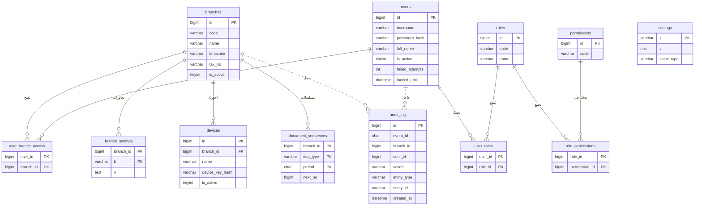
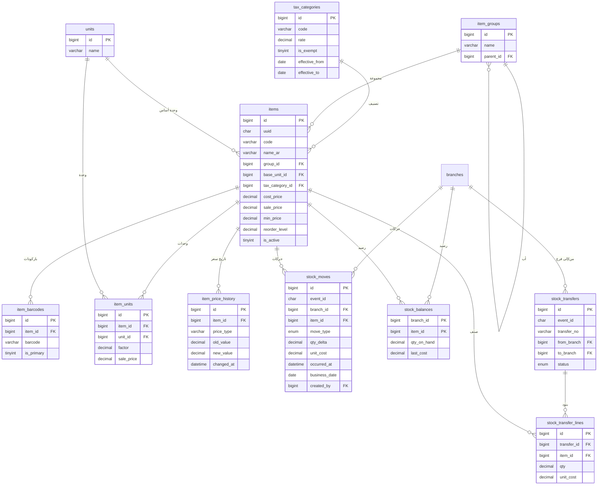
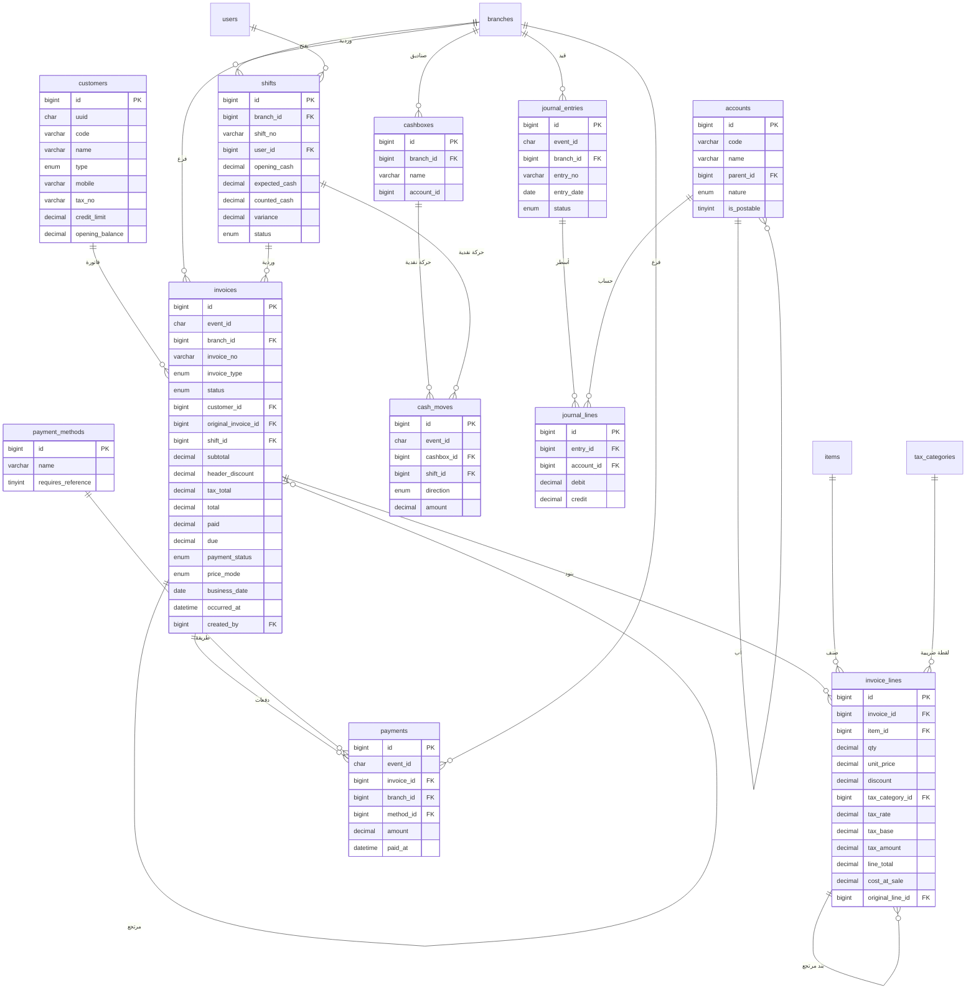
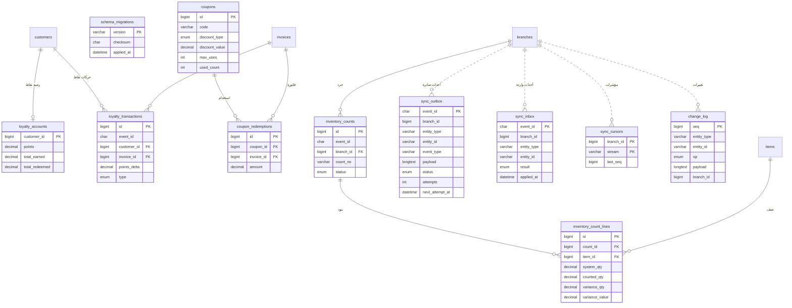

# مخطط الكيانات والعلاقات — ERD

**المصدر الوحيد للحقيقة:** `db/migrations/V001__init.sql`.
**آخر تحقق:** 2026-11-02 — الهجرة تُنشئ **45 جدولًا + View واحد**، و**60 مفتاحًا
أجنبيًا**، وصفر حقول `float`/`double`.
**إضافة V009:** جدولا الخادم المركزي `server_sync_events` و`server_change_log`
يعيشان في قاعدة المركز فقط ولا يظهران في مخططات قاعدة الفرع أدناه.
**الاصطلاحات:** `PK` مفتاح أساسي، `FK` مفتاح أجنبي، وكل المبالغ `DECIMAL`.
الطوابع الزمنية UTC في `DATETIME(6)`، و`business_date` تاريخ محلي.

> الجداول مقسّمة إلى أربعة نطاقات لتكون المخططات قابلة للقراءة. العلاقات
> المرسومة بـ`||..o{` **علاقات منطقية بلا Foreign Key** (جداول المزامنة
> والتدقيق) — وهذا قرار مقصود مذكور في §5.

---

## 1. الهوية والصلاحيات والإعدادات



**ملاحظات:**

- `users` ليست مرتبطة بفرع مباشرة؛ الربط عبر `user_branch_access` (M:N).
- `settings` عامة، و`branch_settings` تتجاوزها لكل فرع.
- `document_sequences` مفتاحها المركّب `(branch_id, doc_type, period)` وتمنع
  تصادم أرقام المستندات بين الفروع وعند العمل دون إنترنت.
- `devices` موجودة في المخطط لكن **لا كود يستخدمها بعد** (لا تسجيل جهاز ولا
  تحقق من `device_key_hash`).
- `audit_log` بلا FK على المستخدم/الفرع عمدًا: يجب أن يبقى السجل حتى لو حُذف
  المرجع، و`branch_id`/`user_id` فيه قد يكونان `NULL` لعمليات النظام.

---

## 2. الأصناف والمخزون



**ملاحظات:**

- `stock_moves` هو **مصدر الحقيقة**؛ `stock_balances` مخزن مؤقت مفتاحه
  `(branch_id, item_id)` ويُحدَّث في نفس معاملة الحركة.
- `move_type`: `purchase`, `purchase_return`, `sale`, `sale_return`, `opening`,
  `adjustment`, `transfer_in`, `transfer_out`, `count_gain`, `count_loss`.
- `item_units` و`item_groups.parent_id` موجودان لكن **لا كود يستخدمهما بعد**؛
  الاستيراد يسطّح شجرة المجموعات.
- `item_price_history` يُكتب عند تغيير سعر البيع من `ItemService`.
- التحويل حالة على مستوى الوثيقة (`draft → sent → received/cancelled`)،
  وحركتا `transfer_out`/`transfer_in` هما الأثر المخزني.

---

## 3. البيع والشراء والمدفوعات والمحاسبة



**ملاحظات:**

- `invoices.invoice_type`: `sale`, `sale_return`, `purchase`, `purchase_return`,
  `opening`. و`status`: `draft`, `posted`, `voided`.
- `invoice_no` فريد لكل `(branch_id, invoice_type, invoice_no)`، والمسلسل من
  `document_sequences`.
- لقطة الضريبة على البند: `tax_category_id`, `tax_rate`, `tax_base`,
  `tax_amount`, `price_mode` — التقارير التاريخية لا تتأثر بتغيّر التصنيف.
- `original_invoice_id` و`original_line_id` يربطان المرتجع بأصله ويمنعان
  إرجاع أكثر من المتاح (مُختبَر).
- `cost_at_sale` (+ `cost_at_sale_incl_tax`) لقطة تكلفة LASTCOST وقت البيع
  (D-10)؛ تقرير الأرباح يعتمد عليها.
- `payments.amount` سالب في حالات رد النقد (مرتجع بيع).
- `accounts` شجرة مبسّطة بـ13 حسابًا من `seed`؛ لا نقل لشجرة الـ177 القديمة.

---

## 4. الولاء والكوبونات والجرد والمزامنة



**ملاحظات:**

- جداول الولاء والكوبونات والجرد **موجودة بلا كود تطبيقي** (0 مراجع في `src/`).
- `sync_outbox.status`: `pending`, `sending`, `sent`, `acked`, `failed`, `dead`.
  لا حذف قبل الإقرار. `attempts` يزيد عند المطالبة، و`next_attempt_at` بوابة
  إعادة المحاولة.
- `sync_inbox.result`: `applied`, `duplicate`, `conflict`, `rejected`.
- `change_log.op`: `upsert`, `delete`.
- جداول المزامنة والتدقيق **بلا Foreign Keys** عمدًا (حجم كتابة عالٍ، وقابلية
  ترحيل/تفريغ دون كسر مراجع). العلاقات فيها منطقية فقط.

---

## 5. قرارات وقيود مهمة

| القرار | التفصيل |
|---|---|
| المحرك والترميز | InnoDB، `utf8mb4_unicode_ci` في كل الجداول |
| المال | `DECIMAL(18,2)` للمبالغ، `DECIMAL(18,4)` للأسعار والكميات والتكاليف؛ معدل الضريبة `DECIMAL(6,3)` |
| الزمن | `DATETIME(6)` UTC، و`business_date DATE` محلي |
| المعرّفات | `BIGINT UNSIGNED AUTO_INCREMENT` + `uuid CHAR(36)` (UUIDv7) للصفوف القابلة للمزامنة |
| `event_id` | `CHAR(36)` فريد في جداول الأحداث: `invoices`, `stock_moves`, `cash_moves`, `payments`, `journal_entries`, `stock_transfers`, `inventory_counts`, `loyalty_transactions`, `sync_outbox`, `sync_inbox` |
| الحذف | `ON DELETE RESTRICT` افتراضيًا للبيانات المالية؛ `CASCADE` للبنود التابعة (بنود الفاتورة، أسطر القيد، بنود التحويل/الجرد) |
| الفواتير | غير قابلة للتعديل بعد الترحيل؛ الإلغاء يضبط `status='voided'` ويُبقي الصف |
| لا FK | `sync_outbox`, `sync_inbox`, `sync_cursors`, `change_log`, `audit_log` |
| CHECK | معدل ضريبة 0–100، كميات غير صفرية، أسعار غير سالبة، أسطر قيد موجبة باتجاه واحد |
| View | `v_stock` = `items × branches` مع رصيد وأساس تكلفة (تُظهر كل صنف مفعّل حتى بلا صف رصيد) |

---

## 6. كتالوج الجداول الـ45

| # | الجدول | الغرض | الكاتب | الحالة في الكود |
|---:|---|---|---|---|
| 1 | `schema_migrations` | إصدارات الهجرات وبصماتها | أداة CLI | مستخدم |
| 2 | `branches` | الفروع | المركز | مستخدم |
| 3 | `settings` | إعدادات عامة | المركز/الفرع | مستخدم |
| 4 | `branch_settings` | تجاوزات إعداد لكل فرع | الفرع | **مخطط فقط** |
| 5 | `roles` | الأدوار | المركز | مستخدم |
| 6 | `permissions` | الصلاحيات | المركز | مستخدم |
| 7 | `role_permissions` | ربط الأدوار بالصلاحيات | المركز | مستخدم |
| 8 | `users` | المستخدمون | المركز | مستخدم |
| 9 | `user_roles` | أدوار المستخدم | المركز | مستخدم |
| 10 | `user_branch_access` | فروع المستخدم | المركز | مستخدم |
| 11 | `devices` | أجهزة الفروع ومفاتيحها | المركز | **مخطط فقط** |
| 12 | `document_sequences` | مسلسلات المستندات | الفرع | مستخدم |
| 13 | `tax_categories` | التصنيفات الضريبية | المركز (الفرع حاليًا) | مستخدم |
| 14 | `item_groups` | مجموعات الأصناف | المركز | مستخدم (بلا أب) |
| 15 | `units` | الوحدات | المركز | مستخدم |
| 16 | `items` | الأصناف والأسعار | المركز (الفرع حاليًا) | مستخدم |
| 17 | `item_barcodes` | الباركودات | المركز | مستخدم |
| 18 | `item_units` | وحدات متعددة للصنف | المركز | **مخطط فقط** |
| 19 | `item_price_history` | تاريخ تغيّر الأسعار | الفرع | مستخدم |
| 20 | `customers` | العملاء والموردون | الفرع | مستخدم |
| 21 | `payment_methods` | طرق الدفع | المركز | مستخدم |
| 22 | `cashboxes` | الصناديق | الفرع | مستخدم |
| 23 | `shifts` | الورديات | الفرع | مستخدم |
| 24 | `cash_moves` | حركات الصندوق | الفرع | مستخدم |
| 25 | `stock_moves` | حركات المخزون (مصدر الحقيقة) | الفرع | مستخدم |
| 26 | `stock_balances` | الرصيد المخزني (Cache) | الفرع | مستخدم |
| 27 | `stock_transfers` | تحويلات بين الفروع | الفرع | مستخدم |
| 28 | `stock_transfer_lines` | بنود التحويل | الفرع | مستخدم |
| 29 | `invoices` | رأس الفاتورة | الفرع | مستخدم |
| 30 | `invoice_lines` | بنود الفاتورة | الفرع | مستخدم |
| 31 | `payments` | الدفعات | الفرع | مستخدم |
| 32 | `accounts` | دليل الحسابات | المركز | مستخدم |
| 33 | `journal_entries` | القيود | الفرع | مستخدم |
| 34 | `journal_lines` | أسطر القيود | الفرع | مستخدم |
| 35 | `loyalty_accounts` | أرصدة نقاط الولاء | الفرع | **مخطط فقط** |
| 36 | `loyalty_transactions` | حركات النقاط | الفرع | **مخطط فقط** |
| 37 | `coupons` | الكوبونات | المركز | **مخطط فقط** |
| 38 | `coupon_redemptions` | استخدام الكوبونات | الفرع | **مخطط فقط** |
| 39 | `inventory_counts` | وثائق الجرد | الفرع | **مخطط فقط** |
| 40 | `inventory_count_lines` | بنود الجرد | الفرع | **مخطط فقط** |
| 41 | `audit_log` | سجل التدقيق | الطرفان | مستخدم |
| 42 | `sync_outbox` | أحداث صادرة | الفرع | مستخدم |
| 43 | `sync_inbox` | أحداث واردة | الطرفان | مستخدم (تسجيل فقط) |
| 44 | `sync_cursors` | مؤشرات السحب | الفرع | مستخدم |
| 45 | `change_log` | تغييرات الأساسيات | الطرفان | مستخدم (محليًا فقط) |

**إحصاء:** 45 جدولًا، منها **36 مستخدمًا في الكود**، و**9 جداول مخطط فقط**
(`branch_settings`, `devices`, `item_units`, `loyalty_accounts`,
`loyalty_transactions`, `coupons`, `coupon_redemptions`,
`inventory_counts`, `inventory_count_lines`).

---

## 7. تعارضات واجب حسمها

| # | التعارض | الأثر |
|---|---|---|
| E-1 | `devices` مُعرَّف لكن المزامنة ترسل `device_id` من الجلسة ولا تُسجّل الجهاز ولا تتحقق من مفتاحه | لا يمكن إبطال جهاز مخترق |
| E-2 | `branch_settings` غير مستخدم؛ الإعدادات تُقرأ من `settings` فقط | لا تجاوزات لكل فرع رغم وجود الجدول |
| E-3 | `items` و`tax_categories` قابلة للتعديل محليًا في الكود، بينما نموذج الفروع يجعل المركز مالكها | تعارض أساسيات بين الفروع |
| E-4 | `change_log` يُكتب محليًا ولا يُرسَل للمركز | الأصناف/العملاء لا تُزامَن صعودًا |
| E-5 | `sync_inbox` يُكتب بلا تطبيق فعلي على الجداول | سحب الأساسيات لا يحدّث البيانات |
| E-6 | `item_units` بلا كود مع أن الاستيراد يقرأ `curr_units` | الوحدات المتعددة غير مدعومة فعليًا |
| E-7 | `invoice_lines` بلا `event_id` مستقل | لا يمكن تتبع بند منفرد في المزامنة |

---

## 8. كيف تُحدَّث هذه الوثيقة

1. أي هجرة جديدة `V002__*.sql` تُضاف كملف مستقل، ولا تُعدَّل `V001` (البصمة
   تمنع ذلك).
2. تُحدَّث المخططات الأربعة والكتالوج في نفس الالتزام الذي يضيف الهجرة.
3. يمكن استخراج العلاقات آليًا من MariaDB:

```sql
SELECT table_name, column_name, referenced_table_name, referenced_column_name
FROM information_schema.key_column_usage
WHERE table_schema = DATABASE() AND referenced_table_name IS NOT NULL
ORDER BY table_name, ordinal_position;
```

---

## 9. المراجع

- `db/migrations/V001__init.sql` — التعريف الكامل.
- `db/rollback/R001__init.sql` — التراجع.
- `docs/ARCHITECTURE.md` §7 — مبادئ المخطط.
- `docs/DATA_MIGRATION_PLAN.md` — مصدر البيانات القديمة.
- `docs/SYNC_PROTOCOL.md` §5 — جداول المزامنة وسلوكها.
