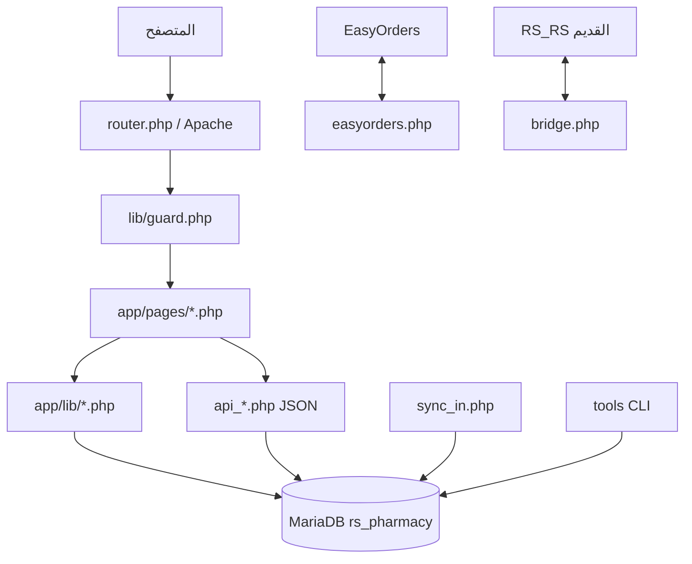
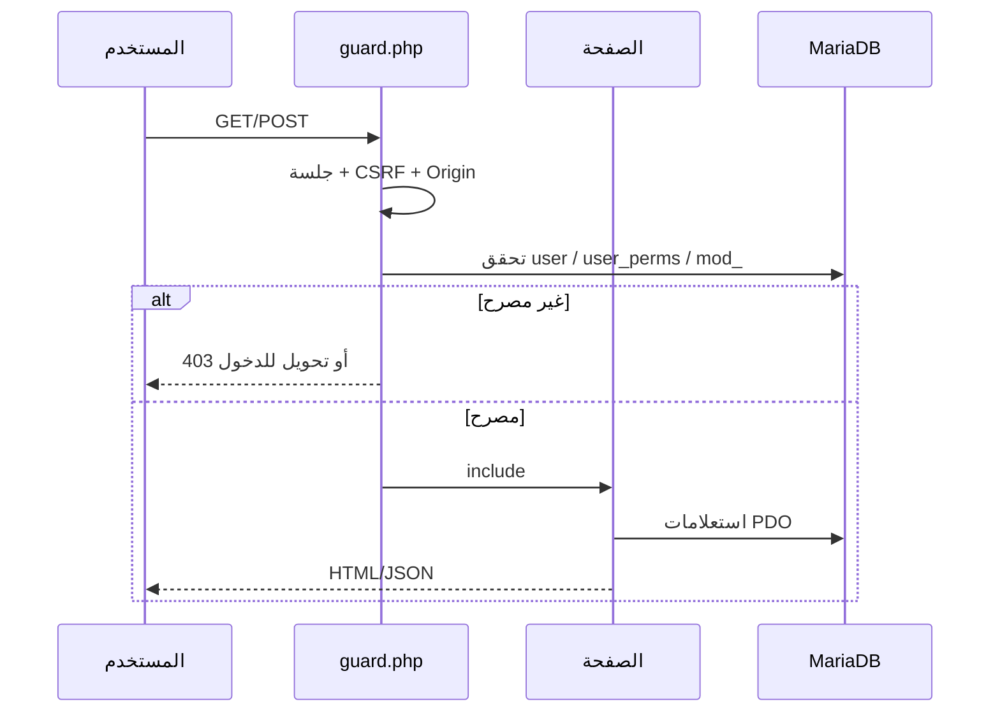
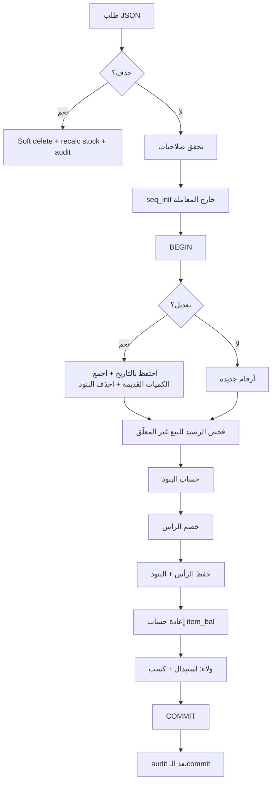

# تحليل النظام القديم — Legacy System Audit

**النظام:** `rs_pharmacy` — مبيعات وصيدلية (PHP 8.2 + MariaDB)
**تاريخ التحليل:** 2026-10-28
**المنهج:** قراءة كود المصدر كاملًا + استعلامات قراءة فقط على المخطط +
تشغيل اختبارات `tests/run_all.php` على `rs_pharmacy_test`.

---

## 1. نظرة معمارية

النظام ليس MVC بالمعنى المتعارف عليه. هو **مجموعة صفحات PHP مستقلة** تشترك
في مكتبات مشتركة، مع طبقة `app/src` قديمة مجمّدة لا تُستخدم.



| الطبقة | الموقع | الدور |
|---|---|---|
| التوجيه | `router.php` + Apache | كل صفحة ملف مستقل |
| الحماية | `app/lib/guard.php` | جلسة + CSRF + Origin + صلاحيات + موديولات |
| الواجهات | `app/pages/*.php` | 100 صفحة HTML/JS |
| منطق الأعمال | `app/lib/*.php` | فواتير، مخزون، ولاء، تسلسل، تدقيق |
| الوصول للبيانات | `app/lib/db.php` (PDO) | اتصال واحد + معاملات |
| المزامنة | `lib/push.php`, `pages/sync_in.php` | دفع/سحب بين النسخ |
| الأدوات | `tools/*.php` | نسخ، فحص، هجرات، تقارير |
| طبقة MVC مجمّدة | `app/src/` | لا تُستخدم ولا تُرحَّل |

**قاعدة الاتصال:** `app/config.php` يقرأ `C:\ProgramData\RS_Own\secrets.php`،
ويحدد اسم القاعدة من `db.name` أو `RS_DB`. لا توجد بيانات اعتماد في المستودع.

---

## 2. تدفق الطلب



- الصفحات العامة: `login.php`, `lang.php`, `ping.php`, `sync_in.php`,
  `migrate_in.php`.
- كل ما عداها يمر بـ `guard.php` الذي:
  1. يبدأ الجلسة ويعيد التوجيه للدخول عند غيابها.
  2. يتحقق من `IS_Deleted` للمستخدم (fail-closed).
  3. يفرض CSRF على POST للنماذج.
  4. يفرض فحص Origin على `api_*` POST.
  5. يطابق اسم الملف مع `cfg_perm_map()`.
  6. يمنع الموديولات المقفولة عبر `app_settings.mod_<screen>`.

---

## 3. المصادقة والجلسات

| البند | السلوك |
|---|---|
| تخزين كلمة المرور | `password_hash(PASSWORD_DEFAULT)` (bcrypt) |
| توافق قديم | إذا كانت القيمة ليست hash يُقارن النص ثم يُعاد تجزئته تلقائيًا |
| الجلسة | ملفات في `data/sessions`، تجديد المعرّف عند الدخول |
| كلمة المرور الخام | لا تُخزَّن ولا تُسجَّل |
| كلمة مرور admin | لا توجد كلمة مرور افتراضية في الكود |
| عدّاد المحاولات | موجود في `auth.php` (مفتاح md5 للـIP) |

**ملاحظة أمنية:** وجود توافق نصّي قديم يعني أن أي كلمة مرور لم تُحدَّث بعد
ما زالت قابلة للمقارنة النصّية حتى أول دخول ناجح. عند الترحيل يجب إجبار
إعادة التعيين أو ترحيل الـhash فقط.

---

## 4. الصلاحيات

نموذجان متكاملان:

1. **صلاحيات الشاشات** — `user_perms(user_id, perm, val)`، والقيم:
   `m_sale`, `m_buy`, `m_item`, `m_stock`, `m_reports`, `m_money`, `m_cust`,
   `m_admin`.
2. **أعلام الفواتير الحساسة** — أعمدة في `users`: `edit_inv`, `edit_disc`,
   `edit_price`, `edit_date`.

قواعد مؤكدة من `lib/cfg.php` و`lib/guard.php`:

- `admin` يتجاوز كل الفحوص.
- مستخدم بلا أي صف في `user_perms` = **لا وصول**.
- `m_item` تُمنح ضمنًا لمن لديه `m_sale` أو `m_buy`.
- أي خطأ في قراءة الصلاحيات = رفض (fail-closed).
- `edit_inv` مطلوب للتعديل والحذف.
- `edit_disc` مطلوب لخصم البند/الرأس.
- `edit_price` مطلوب لتغيير سعر البيع.
- `edit_date` مطلوب لتأريخ الفاتورة؛ بدونه تُحفظ بتاريخ اليوم.
- `admin` يحصل على الأعلام الأربعة كلها تلقائيًا.

خريطة الشاشات الكاملة (70+ مدخلًا) في `lib/cfg.php::cfg_perm_map()`.
الملفات غير المذكورة في الخريطة لا تُفحص صلاحيتها (لكنها ما زالت تحتاج دخولًا).

---

## 5. وحدات النظام

| الوحدة | الصفحات الرئيسية | الحالة |
|---|---|---|
| البيع | `sale_rs.php`, `sale.php`, `msale.php`, `api_sale_*.php` | نشطة |
| الشراء | `buy_rs.php`, `buy.php`, `api_buy_*.php` | نشطة |
| الأصناف | `items.php`, `item_edit.php`, `api_item*.php`, `barcode.php` | نشطة |
| المخزون | `stock.php`, `gardscan.php`, `api_gard.php`, `predict.php`, `order.php` | نشطة |
| العملاء | `customers.php`, `cust_bal.php`, `cust_groups.php`, `coupons.php` | نشطة |
| الولاء | `loyalty.php`, `api_loyalty.php` | نشطة |
| المال والمحاسبة | `money.php`, `transfers.php`, `journal.php`, `trial.php`, `acc.php` | نشطة |
| التقارير | `reports.php`, `board.php`, `dash.php`, `stock.php` | نشطة |
| الورديات | `shifts.php`, `shift_rep.php`, `day_rep.php` | نشطة جزئيًا |
| الإدارة | `admin.php`, `users.php`, `user_mgmt.php`, `settings.php`, `control.php` | نشطة |
| المزامنة | `sync.php`, `sync_in.php`, `bridge.php`, `easy.php` | نشطة |
| الموارد البشرية | `hr_*.php`, `salary.php` | نشطة |
| موديولات مقفولة | `areas, banks, branches, day_rep, ext_voucher, hr_comm, hr_depts, hr_emp, hr_sales, safes, stocks, transfers, vouchers, vouchershop` | `mod_*=0` |

> «مقفول» هنا يعني مخفي/محجوب عبر `app_settings`، وليس محذوفًا. الكود موجود
> ويمكن تفعيله.

---

## 6. طبقة البيانات والترقيم

- PDO مع `ERRMODE_EXCEPTION`، استعلامات مُعاملة (prepared) في معظم المسارات.
- لا Foreign Keys. العلاقات منطقية فقط.
- `inv` و`inv_sub` بلا Primary Key حقيقي؛ `proc_id` فريد في `inv` فقط،
  و`inv_sub.id` فريد.
- `rs_seq(name, val)` هو مصدر الأرقام: `seq_proc`, `seq_inv`, `seq_sub`,
  `tbl_currencies_id`.
- الترقيم يبدأ من **10,000,000** للفواتير المحلية (فرع 99) لتفادي التصادم مع
  أرقام النظام القديم.
- `seq_init()` تُستدعى خارج المعاملة لأنها قد تُنشئ جدولًا (DDL = commit ضمني).
- الفواتير المحلية تُكتب بـ `branch=99`، والفواتير المستوردة تُقرأ للعرض فقط.

---

## 7. دورة حياة فاتورة البيع

المرجع الكامل: `app/pages/api_sale_save.php`.



نقاط مهمة:

- الحذف **ناعم** (`IS_Deleted=1` + `user_IS_Deleted`)، ويتطلب `edit_inv`.
- التعديل يتطلب `edit_inv`، ويحذف بنود الفاتورة ثم يعيد إدراجها.
- السعر يُعاد قراءته من `currencies.sale_price` إلا بوجود `edit_price`.
- الخصم يُصفَّر إن لم يوجد `edit_disc`.
- فحص الرصيد يتم فقط للبيع (`pt=1`) وغير المعلّق (`IS_Temp=0`).
- الأصناف بلا صف في `item_bal` **لا تُفحص** (لا جرد لها).
- عند التعديل تُضاف كميات الفاتورة القديمة إلى المتاح.
- `paid` يُقصّ إلى `tot_net`.
- لا تُنشأ قيود محاسبية ولا حركة خزينة من الفاتورة.

---

## 8. دورة حياة فاتورة الشراء

المرجع: `app/pages/api_buy_save.php`.

- التاريخ **دائمًا** `NOW()` — لا يمكن تأريخ الشراء في الماضي.
- لا يُسجَّل المورد (`cust_id` يبقى 0).
- عند الإنشاء: `tot_purch = tot_sale = tot_net` (لا هامش ربح محسوب).
- تاريخ الصلاحية يقبل `YYYY-MM-DD` أو `MM/YY` ويُحوَّل لتاريخ كامل.
- الحذف والتعديل يتطلبان `edit_inv`، والخصم يتطلب `edit_disc`.
- يعيد حساب `item_bal` للأصناف المتأثرة.
- لا قيد محاسبي آلي.

---

## 9. المخزون

- `item_bal` جدول **مشتق** يُعاد حسابه عند كل حفظ/حذف/تعديل فاتورة.
- معادلة الإشارة في `lib/items.php::stock_recalc_items`:

```text
+ val  إذا (IS_Buy=1 AND proc_type=1)   -- شراء
       أو proc_type=3                  -- مخزون أول/توريد
       أو (IS_Buy=0 AND proc_type=2)   -- مرتجع بيع
- val  غير ذلك                        -- بيع / مرتجع شراء
مع تجاهل IS_Temp=1 و IS_Deleted=1
```

- لا توجد Triggers؛ أي تعديل مباشر على `inv` لا يحدّث الرصيد.
- فحص الرصيد في `stock_shortage` يجمّع الكميات لكل صنف ويقارن بـ`item_bal.bal`
  بسماحية `0.0001`، ويعيد أول صنف ناقص.
- `item_bal` لا يحتوي صفًا لكل صنف؛ 0 صفوف حاليًا في الإنتاج النظيف.

---

## 10. الولاء والعروض

- `loyalty(cust_id, points, total_earned, total_redeemed)`.
- `loyalty_log` يسجل `type` (كسب/استبدال) و`inv_id` و`note`.
- معدل الكسب من `app_settings.loy_earn` (افتراضي 1 نقطة/جنيه).
- الكسب والاستبدال يتمّان داخل معاملة الفاتورة.
- الاستبدال يفشل بهدوء إذا لم تكفِ النقاط (`loyalty_redeem` يعيد false
  ويُصفَّر الطلب) — لا رسالة خطأ للمستخدم.
- `coboun` كوبونات خصم بتاريخ بداية/نهاية وحالة تفعيل.
- `voucher` / `voucher_cust` قسائم مشتريات منفصلة.

---

## 11. الورديات والجرد

### الورديات
- `wardya` جدول مستقل: فتح/قفل فقط.
- **لا يوجد `wardya_no` في `inv`** — الفواتير غير مرتبطة بالوردية.
- لا حساب تلقائي للنقدية المتوقعة/الفرق.

### الجرد
- `count_list` حوض السكانر (كميات `double`).
- `gard` / `gard_sub` وثيقة الجرد (كميات `int`، `sys_Qty` لقطة).
- `settlement` و`settlement_done` موجودان لكن **لا يوجد تطبيق تسوية** يحدّث
  `item_bal` بعد الجرد.
- الجرد لا يولّد فاتورة فروقات تلقائيًا.

---

## 12. المحاسبة

- `restrictions` (رأس) + `restrictions_sub` (بنود مدين/دائن).
- الأنواع: 11 قبض، 12 صرف، 13 تحويل.
- `money.php` و`transfers.php` ينشئان السندات.
- `journal.php` قيد يدوي متعدد السطور.
- `accounts_index` شجرة حسابات (177 حسابًا).
- **لا تحقق من توازن القيد**، ولا ربط آلي بين الفاتورة والقيد/الخزينة.
- الحقول المالية في `restrictions_sub` من نوع `double` — دقة غير كافية.
- `trial.php` ميزان مراجعة وكشف حساب برصيد متحرك.

---

## 13. التقارير

| التقرير | الصيغة |
|---|---|
| أرباح المبيعات | إيراد − (كمية × آخر سعر شراء حتى تاريخ البيع) |
| مبيعات اليوم | بيع (`proc_type=1`) − مرتجع بيع (`proc_type=2`) |
| حركة يومية/تحليل/إجماليات | تجميع من رؤوس `inv` |
| مخزون | `v_stock` = `currencies LEFT JOIN item_bal` |
| أصناف وصلت حد الطلب | `currencies.limit` مقابل الرصيد |
| تقارير الحسابات | من `restrictions_sub` + `accounts_index` |

**تعريف التكلفة:** آخر سعر شراء (`LASTCOST`) من `inv_sub.exchange_price`
ناقص `discount` لفواتير الشراء/التوريد غير المحذوفة، حتى تاريخ البيع.
المرتجعات مستبعدة من حساب الربح.

---

## 14. المزامنة الحالية

### الدفع (`lib/push.php`)
- قائمة 31 جدولًا قابلة للدفع.
- ثلاثة أنماط:
  - `table_swap`: **DELETE كامل ثم INSERT** (خطر فقدان تعديلات).
  - `table_upsert`: `REPLACE INTO` = **Last-Write-Wins**.
  - `inv_batch`: حذف/إدراج حسب `proc_id` للفواتير.
- التوكن من `secrets.php`؛ لا `event_id`، ولا outbox، ولا idempotency.

### الاستقبال (`pages/sync_in.php`)
- `POST` فقط.
- توكن `X-RS-Token` إلزامي.
- gzip + حد 6 MB.
- حد 120 طلبًا/دقيقة لكل IP، و10 محاولات توكن خاطئ/10 دقائق.
- يسجّل في `audit_log` و`push.log`.

### الفجوات
| المطلوب | الحالة |
|---|---|
| `event_id` فريد | ❌ |
| Idempotency | ❌ |
| Outbox/Inbox | ❌ |
| إعادة محاولة بتدرج | جزئي (خارجي) |
| حل تعارضات دلالي | ❌ (LWW) |
| ترتيب الأحداث | ❌ |
| مزامنة فواتير مع البنود كوحدة | `inv_batch` فقط |

---

## 15. الفروع

- `branches` يحتوي صفًا واحدًا: «الفرع الرئيسي».
- `branch=99` مذكور في **35 موضعًا فقط**، أغلبها دوال الحفظ والورديات.
- معظم استعلامات التقارير **بلا فلتر فرع**.
- النموذج الفعلي: قاعدة بيانات مستقلة لكل فرع (`db.name` أو `RS_DB`) وليس
  تعدد فروع داخل قاعدة واحدة.
- `branch` موجود في `inv`, `wardya`, `branches`, `stocks`, `safes`,
  `salesmen`, `restrictions`, `gard`, `customers`.

**الاستنتاج:** النظام الحالي أحادي الفرع عمليًا. دعم عدة فروع في التطبيق
الجديد يتطلب تصميمًا جديدًا، لا مجرد إضافة `WHERE branch=?`.

---

## 16. الأمان — النتائج

| البند | التقييم |
|---|---|
| CSRF للنماذج | ✅ جيد |
| فحص Origin لـ API | ✅ جيد |
| تجزئة كلمة المرور | ✅ bcrypt مع ترقية تدريجية |
| توافق نصّي قديم | ⚠️ يجب إزالته عند الترحيل |
| حد المحاولات | ✅ موجود |
| صلاحيات fail-closed | ✅ |
| أسرار خارج الويب | ✅ |
| Session files | ⚠️ داخل `data/` — يجب أن تبقى خارج الويب |
| SQL Injection | ✅ لا حالات واضحة؛ لكن بعض الاستعلامات تبني `IN (...)` بأرقام `intval` |
| DDL من الويب | ⚠️ `migrate_in.php` يطبّق مانيفست مخطط بتوكن |
| `root` بلا كلمة مرور | ⚠️ يدوي فقط — يجب تأمينه |
| سجل تدقيق | ✅ موجود لكنه محدود (14 صفًا) |

---

## 17. الأداء

- استعلامات التقارير تجمع من `inv` مباشرة؛ لا جداول تلخيص.
- فهارس جيدة على `inv(branch,id)`, `inv(branch,proc_id)`, `inv(date)`,
  `inv(IS_Deleted,IS_Buy,proc_type)`, `inv_sub(proc_id)`, `inv_sub(currency_from)`.
- `stock_recalc_items` يعيد حساب الأصناف المتأثرة فقط (وليس كل المخزون).
- صفحات التقارير تحدّ النتائج بـ5,000 صف وتدعم CSV.
- لا Cache طبقة تطبيق؛ `app_settings` تُقرأ مرة لكل طلب.

---

## 18. الديون التقنية

1. **لا Foreign Keys** → يتامى بيانات ممكنة (حدث فعلًا: 33 صف ولاء يتيم).
2. **لا Primary Key** على `inv` و`inv_sub` → تكرار/تحديث جماعي خطر.
3. **`double` في حقول مالية** (`accounts_index`, `restrictions_sub`,
   `gard_sub`) → فروق تقريب.
4. **شاشات فواتير مكررة** (`sale.php`, `sale_rs.php`, `msale.php`) بسلوك
   مختلف قليلًا.
5. **100 صفحة مستقلة** بلا طبقة أعمال موحدة → تكرار تحقق وحساب.
6. **`IS_Buy` + `proc_type`** دلالتان متداخلتان بمعنى معاكس بين الرأس والبنود.
7. **إعدادات key/value** بلا مخطط → أخطاء صامتة.
8. **لا ربط محاسبي** بين الفواتير والخزائن/القيود.
9. **الوردية غير مرتبطة بالفاتورة**.
10. **الجرد لا يسوّي المخزون**.
11. **مزامنة LWW** غير صالحة لتعدد الفروع.
12. **الحقول الضريبية موجودة وغير مستخدمة**.
13. **تسميات عربية داخل الكود** وصفحات RTL بلا نظام i18n كامل.
14. **`app/src` ميت** ويشتت المطورين.

---

## 19. ما نعيد استخدامه (منطق لا كود)

| الأصل | كيف يُستفاد |
|---|---|
| مصفوفة أنواع الفواتير | تُصاغ كـEnums واضحة في VB.NET |
| معادلة إشارة المخزون | تُنقل كقاعدة عمل مع اختبارات |
| فحص الرصيد والسماحية | يُنقل مع تحسين: فحص كل الأصناف |
| ترقيم 10M+ | يُستبدل بمسلسل مركزي آمن عبر `event_id` |
| نموذج الصلاحيات | يُعاد تصميمه كأدوار + أذونات دقيقة |
| معادلات التقارير | تُثبَّت كاختبارات مرجعية (Golden numbers) |
| تدفق شاشة البيع | يُستخدم كمرجع UX |
| فكرة `item_bal` | تبقى Cache لكن مع Source of Truth = `stock_moves` |
| الولاء | يُنقل مع معاملة صريحة ورفض واضح عند نقص النقاط |
| التدقيق | يُوسَّع لكل عملية حساسة |

---

## 20. ما نتخلص منه

- `app/src` بالكامل.
- `twreed_srf` / `twreed_srf_sub` (محذوف المحتوى، والجداول مرشحة للحذف).
- جداول النسخ `*_bak_20261028`.
- `_orphan_sub`.
- الحقول غير المستخدمة في الفواتير (ضريبة، مطاعم، توصيل قديم، `pc`, `persons` ...)
  إلا ما يثبت أنه مطلوب.
- أنماط المزامنة `table_swap` و`table_upsert`.
- أي اعتماد على `root` أو DDL من الويب.

---

## 21. استنتاج

النظام القديم **يعمل ومُختبَر**، لكنه بُني على قاعدة بيانات بلا قيود، ومنطق
أعمال موزّع على صفحات، ومزامنة LWW. القيمة الحقيقية فيه هي **قواعد العمل
والتجربة التشغيلية**، وليست البنية. التطبيق الجديد يجب أن:

1. يفصل منطق الأعمال في طبقة واحدة قابلة للاختبار.
2. يجعل `stock_moves` مصدر الحقيقة للمخزون، و`item_bal` مجرد Cache.
3. يجعل كل عملية مالية/مخزنية حدثًا ذريًا له `event_id`.
4. يبني المزامنة على Outbox/Inbox وليس على استبدال جداول.
5. يفرض الفروع في كل استعلام من اليوم الأول.

هذه الاستنتاجات هي أساس `docs/BUSINESS_RULES.md` و`docs/DATABASE_SCHEMA.md`
و`docs/FEATURE_MAPPING.md`.
