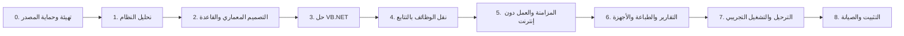

# خطة التنفيذ — Roadmap

**آخر تحديث:** 2026-10-28
**الأساس:** تعليمات المشروع (المراحل 0–8) + تحليل المرحلة 1
**القاعدة الحاكمة:** لا مرحلة تبدأ قبل استيفاء بوابة المرحلة السابقة (بند 13
من التعليمات).

---

## 1. نظرة عامة

| # | المرحلة | المدة التقديرية | المخرج الرئيسي | البوابة |
|---|---|---:|---|---|
| 0 | التهيئة وحماية المصدر | 1–2 يوم | أرشيف + بصمات + `PROJECT_STATUS.md` | ✅ منجزة |
| 1 | تحليل النظام القديم | 3–5 أيام | 4 وثائق + مخاطر/أسئلة + تقرير | **مراجعة المالك** |
| 2 | التصميم المعماري وقاعدة البيانات | 6–9 أيام | `ARCHITECTURE.md`, `SYNC_PROTOCOL.md`, `DATA_MIGRATION_PLAN.md`, ERD, SQL + Rollback | اعتماد التصميم |
| 3 | إنشاء حل VB.NET | 6–8 أيام | حل يبني ويدخل ويتصل بقاعدة اختبار | بناء + اختبارات اتصال |
| 4 | نقل الوظائف بالتتابع | 20–30 يومًا | وحدات الأعمال كاملة + اختبارات | قبول كل وظيفة قبل التالية |
| 5 | المزامنة والعمل دون إنترنت | 8–12 يومًا | Outbox/Inbox + API مركزي | اختبار انقطاع/تعارض |
| 6 | التقارير والطباعة والأجهزة | 4–6 أيام | تقارير مطابقة + طباعة مُختبَرة | مطابقة أرقام مرجعية |
| 7 | الترحيل والتشغيل التجريبي | 5–8 أيام | ترحيل مُتحقَّق + تشغيل متوازٍ | توقيع المالك |
| 8 | التثبيت والصيانة | 3–5 أيام | مثبت + تحديث + أدلة تشغيل | تسليم نهائي |

**الإجمالي التقديري:** 56–85 يوم عمل لمطور واحد + مراجعة مالك دورية.
**لا يشمل:** انتظار قرارات المالك، أو تعلّم أدوات، أو إعادة تصميم بعد الاعتماد.

> المدد تقديرية لا تعاقدية. تُحدَّث بعد المرحلة 3 عند قياس السرعة الفعلية.

---

## 2. المرحلة 0 — التهيئة وحماية المصدر (منجزة)

**المخرج:** `docs/PHASE_0_INVENTORY.md`، أرشيف المصدر، نسخة القاعدة، بصمات
`SHA-256`، لقطة المخطط، سجل الاختبارات 72/72، `PROJECT_STATUS.md`، `.gitignore`.

**بوابة الخروج:** المصدر لم يُعدَّل، والإنتاج لم يُلمس. ✅

---

## 3. المرحلة 1 — تحليل النظام القديم (منجزة، بانتظار المراجعة)

**المخرج:**
- `docs/LEGACY_SYSTEM_AUDIT.md`
- `docs/DATABASE_SCHEMA.md`
- `docs/BUSINESS_RULES.md`
- `docs/FEATURE_MAPPING.md`
- `docs/RISKS_AND_QUESTIONS.md`
- `docs/ROADMAP.md` (هذا الملف)
- `docs/PHASE_1_REPORT.md`

**بوابة القبول:**
1. المالك راجع قواعد العمل وأقرّها أو صحّحها.
2. المالك أجاب على الأسئلة الحرجة: **Q-05/Q-06/Q-17/Q-18 محسومة**؛
   المتبقي **Q-13** (اعتماد `BRANCH_MODEL_PROPOSAL.md` + B-01…B-08)
   وتأكيدات الضريبة T-A/T-B/T-C.
3. المالك اعتمد ترتيب الموجات وحذف/دمج الشاشات.
4. لا كود تطبيق قبل ذلك (بند 15).

> **استثناء موثّق:** بموجب تفويض المالك في 2026-10-28 («افعل كل ما تستطيع
> للانتهاء من المشروع») يعمل الفريق على المرحلة 2 وما بعدها بالافتراضات
> والتوصيات المسجلة، مع توثيق كل قرار في التقارير. أي افتراض خاطئ يُصحَّح
> لاحقًا بتغيير مُدار، ولا يُعاد أي عمل بلا أثر.

---

## 4. المرحلة 2 — التصميم المعماري وقاعدة البيانات

**الهدف:** مخطط جديد كامل + بروتوكول مزامنة + خطة ترحيل، قبل أي كود واجهة.

### المهام

1. تثبيت قرارات المخطط (`Q-07`…`Q-13`, `Q-22`) + قرارات الضريبة
   (`TAX_DESIGN.md`) + نموذج الفروع (`BRANCH_MODEL_PROPOSAL.md`).
2. `docs/ARCHITECTURE.md`: طبقات الحل، تدفق البيانات، حدود الثقة، مسؤولية
   كل مشروع (UI/Business/Data/Sync/Infrastructure/Tests)، سيناريوهات الفشل.
3. `docs/SYNC_PROTOCOL.md`: شكل الحدث، `event_id`، `branch_id`، `device_id`،
   إصدار الرسالة، التوقيع/TLS، الـACK، إعادة المحاولة، التعارضات، حالات
   الانقطاع والترتيب.
4. `docs/DATA_MIGRATION_PLAN.md`: ما يُنقل، ما لا يُنقل، التحويلات، فحوص
   قبل/بعد، معايير المطابقة، خطة الرجوع.
5. `docs/DATABASE_DESIGN.md`: كل جدول، أعمدة، أنواع، قيود، فهارس، سبب الوجود،
   ومن يكتب فيه.
6. مخطط ERD (Mermaid) لكل النطاقات.
7. سكربتات SQL مرقّمة: `db/migrations/V001__...sql` + `db/rollback/R001__...sql`
   تعمل من الصفر وعلى `rs_pharmacy_test`.
8. تصميم `stock_moves` + `stock_balances` + `invoices` + `payments` +
   `sync_outbox/inbox` + `audit_log` + `document_sequences`.
9. طبقة وصول في VB.NET: اتصال، معاملات، `branch_id` إلزامي، تحويلات DECIMAL.
10. تصميم الضريبة في المخطط: `tax_categories` + لقطات البند + تقارير + QR.
11. أدوات CLI: `db:create`, `db:migrate`, `db:rollback`, `db:seed`, `db:verify`.
12. اختبارات مخطط: FK، فهارس فريدة، منع حذف مرجعي، توازن القيد، عزل الفرع،
    مطابقة الضريبة، ومنع الرصيد السالب.

### المخرج

- الوثائق الأربع أعلاه + ERD.
- SQL إصدار أول + سكربتات تراجع.
- طبقة وصول مُختبَرة.

### بوابة القبول

- [ ] `db:migrate` من قاعدة فارغة ينجح في < 30 ثانية.
- [ ] `db:rollback` يعيد الحالة السابقة بلا فقدان بنية.
- [ ] كل جدول تشغيلي فيه `branch_id` غير قابل للـNULL أو مبرَّر.
- [ ] كل علاقة حرجة لها FK.
- [ ] كل حقل مالي `DECIMAL` (لا `float`/`double`).
- [ ] اختبارات القيود والعزل تمر.
- [ ] مراجعة المالك للتصميم.

**خارج النطاق:** لا شاشات، لا منطق بيع، لا مزامنة فعلية.

---

## 5. المرحلة 3 — إنشاء حل VB.NET

**الهدف:** تطبيق يفتح، يسجّل الدخول، يفرض الصلاحيات، ويتصل بقاعدة اختبار —
بلا وظائف بيع.

### المهام

1. تثبيت .NET SDK + IDE (قرار Q-01) والتحقق على Windows 10 19045.
2. حل `RsSales.sln`: `RsSales.UI`, `.Business`, `.Data`, `.Sync`,
   `.Infrastructure`, `.Tests`.
3. إعدادات اتصال خارج الكود (DPAPI/Credential Manager) + ملف نموذجي بلا أسرار.
4. طبقة اتصال: فتح/إغلاق صحيح، استعلامات معاملات، مهلة، إعادة اتصال.
5. `LoginForm` + bcrypt + قفل المحاولات + انتهاء الجلسة + تدقيق دخول.
6. `MainForm` + قائمة وحدات حسب الصلاحيات + `user_branch_access`.
7. تسجيل أخطاء منظّم بلا بيانات حساسة (Serilog أو مكافئ) + تدوير.
8. هيكل مثبت/تحديث أولي (Inno Setup أو WiX) + إصدار دلالي.
9. CI محلي: `dotnet build` + `dotnet test`.
10. `HealthCheck` لقاعدة البيانات المحلية والمركزية.

### بوابة القبول

- [ ] `dotnet build` بلا أخطاء ولا تحذيرات حرجة.
- [ ] دخول ناجح/فاشل/مقفل مُختبَر.
- [ ] مستخدم بلا صلاحية لا يرى الوحدة ولا يصل إليها.
- [ ] لا أسرار في المستودع ولا في السجلات.
- [ ] الاتصال بقاعدة اختبار ناجح، وفشل الاتصال يعطي رسالة مفهومة.
- [ ] تشغيل على Windows 10 19045 مُتحقَّق.

---

## 6. المرحلة 4 — نقل الوظائف بالتتابع

**القاعدة:** وظيفة واحدة كاملة (منطق + واجهة + اختبارات + مطابقة) قبل التالية.
الترتيب أدناه مأخوذ من التعليمات ومعدَّل حسب اعتماديات التحليل.

| # | الوظيفة | الاعتمادية | البوابة |
|---|---|---|---|
| 4.1 | الإعدادات، الدخول، المستخدمون، الصلاحيات، الفروع | المرحلة 3 | مصفوفة أدوار مُختبَرة |
| 4.2 | الأصناف، التصنيفات، الباركود، الوحدات | 4.1 | استيراد 29,595 صنفًا + بحث |
| 4.3 | العملاء والموردون | 4.2 | كشف حساب + حد ائتمان |
| 4.4 | المخزون الافتتاحي وحركات المخزون | 4.2, 4.3 | `SUM(qty_delta)=qty_on_hand` |
| 4.5 | المشتريات والاستلام وضريبة المدخلات | 4.3, 4.4 | فاتورة شراء بمورد وتاريخ مستند |
| 4.6 | المبيعات والخصومات والمدفوعات والضريبة والطباعة | 4.2–4.5 | سيناريو التعليمات كامل + فاتورة ضريبية |
| 4.7 | المرتجعات والإلغاء والتسويات | 4.6 | مرتجع جزئي/كلي + عكسي |
| 4.8 | التحويلات بين الفروع | 4.4, 5 (جزئيًا) | حالتان: مرسل/مستلَم |
| 4.9 | المصروفات والورديات والصناديق | 4.6 | نقدية متوقعة = فعلية |
| 4.10 | التقارير ولوحات المعلومات والتصدير | 4.6–4.9 | مطابقة أرقام ذهبية |

### اختبار قبول المبيعات (من التعليمات — إلزامي)

- [ ] فاتورة صنف واحد.
- [ ] فاتورة متعددة الأصناف.
- [ ] باركود غير موجود.
- [ ] كمية غير متاحة.
- [ ] خصم داخل الصلاحية وخارجها.
- [ ] تقريب المبالغ.
- [ ] دفع جزئي أو متعدد الطرق.
- [ ] فشل حفظ جزء من الفاتورة → تراجع كامل.
- [ ] إعادة المحاولة → لا فاتورة مكررة.
- [ ] طباعة الفاتورة وإعادة طباعتها.
- [ ] مرتجع جزئي وكلي.

**بوابة المرحلة:** كل بند أعلاه مُختبَر ومسجَّل، وكل وظيفة حدّثت
`FEATURE_MAPPING.md` و`PROJECT_STATUS.md`.

---

## 7. المرحلة 5 — المزامنة والعمل دون إنترنت

**المهام**

1. `sync_outbox` يُكتب في نفس معاملة الفاتورة/الحركة.
2. خدمة إرسال عبر HTTPS إلى API مركزي، مع `event_id` و`branch_id` و
   `device_id` وإصدار الرسالة والتوقيت والتوقيع.
3. `sync_inbox` في المركز يمنع معالجة `event_id` مرتين ويعيد ACK قابلًا للتخزين.
4. إعادة محاولة بتدرج (1s, 5s, 30s, 5m, 30m, 2h) + حالة `dead` + إعادة يدوية.
5. سحب الأصناف/الأسعار/الصلاحيات عبر `sync_cursors`.
6. كشف تعارض الأصناف والأسعار + شاشة قرار بشري.
7. تحويل مخزون بحالتين وتأكيد متبادل.
8. مصادقة لكل فرع + تدوير أسرار + TLS.
9. مراقبة: آخر مزامنة، عدد المنتظر، الأخطاء.
10. تحديث إصدار التطبيق/المخطط مع دعم الفروع المنقطعة.

### حالات اختبار إلزامية (من التعليمات)

- [ ] انقطاع الإنترنت قبل الإرسال.
- [ ] انقطاعه أثناء الإرسال.
- [ ] وصول ACK وضياعه قبل وصوله للفرع.
- [ ] إرسال الحدث نفسه مرات متعددة.
- [ ] إعادة تشغيل التطبيق وأحداث غير مرسلة.
- [ ] اختلاف ترتيب وصول الأحداث.
- [ ] فرعان يعدلان بيانات مشتركة.
- [ ] تحويل بضاعة مرسل دون تأكيد استلام.
- [ ] إصدار قديم يتصل بالمركز بعد انقطاع.

**بوابة المرحلة:** كل الحالات أعلاه موثّقة النتيجة، وصفر فواتير مفقودة/مكررة.

---

## 8. المرحلة 6 — التقارير والطباعة والأجهزة

**المهام**

1. مقارنة كل تقرير بالنظام القديم: المرشحات، الفترات، التجميعات، التقريب.
2. تثبيت تعريف الربح (سياسة Q-06) واختباره بأرقام مرجعية.
3. اختبار طابعة A4 + حرارية 80mm + إعادة الطباعة.
4. اختبار السكانر والباركود والملصقات.
5. التحقق من العربية وRTL والخطوط وتنسيق الأرقام والتواريخ.
6. اختبار التصدير CSV/Excel وصلاحيات الوصول للملفات.

**بوابة المرحلة**

- [ ] كل تقرير مطابق لنتيجة مرجعية موثقة.
- [ ] الطباعة مطابقة للنموذج المعتمد على الجهاز الفعلي.
- [ ] العربية سليمة في كل الشاشات والتقارير.
- [ ] التصدير يعمل بصلاحيات صحيحة.

---

## 9. المرحلة 7 — الترحيل والتشغيل التجريبي

**المهام**

1. نسخة احتياطية من الأصل + بصمة.
2. ترحيل على `rs_pharmacy_test` فقط.
3. مطابقة: عدد السجلات، المجاميع المالية، الأرصدة، الفواتير، المرتجعات.
4. فحص المفاتيح المفقودة/المكررة والعلاقات غير السليمة.
5. تقرير فروق واضح — لا تجاهل.
6. تشغيل متوازٍ/ظل بلا تكرار أثر مالي.
7. فرع واحد أولًا + خطة رجوع.
8. موافقة المالك قبل الإنتاج.
9. توثيق خطة القطع والتحويل وخطة الرجوع.
10. تحديد موعد تحديث الفروع وخطة الفروع غير المتصلة.

**بوابة المرحلة:** تطابق ضمن معايير متفق عليها + نسخة قابلة للاستعادة +
خطة رجوع مجرّبة + توقيع المالك.

---

## 10. المرحلة 8 — التثبيت والصيانة

**المهام**

1. مثبت Windows Forms واضح.
2. إجراء منفصل لتثبيت وإعداد MariaDB/MySQL لخادم الفرع.
3. خدمة مزامنة بصلاحيات ويندوز مناسبة (عند الحاجة).
4. فحص اتصال محلي/مركزي + حالة آخر مزامنة + عدد المنتظر.
5. آلية تحديث آمنة للفروع المنقطعة.
6. أدلة: النسخ الاحتياطي، الاستعادة، التحديث، استكشاف الأخطاء.
7. لا أسرار في Git ولا في ملفات التثبيت العامة.
8. سجلات قابلة للفحص مع تدوير وبلا بيانات حساسة.

**بوابة المرحلة:** تسليم موقَّع + دليل تشغيل + استرجاع مُختبَر + تدريب منتهٍ.

---

## 11. الاعتماديات والمسارات الحرجة

| الاعتمادية | تؤثر على | الحل |
|---|---|---|
| قرار .NET + تثبيت | المرحلة 3 وما بعدها | إنجازه خلال أسبوع من اعتماد المرحلة 1 |
| Q-05/Q-06/Q-17/Q-18 | تصميم القاعدة | ✅ محسومة 2026-10-28 |
| Q-13 + B-01…B-08 | تصميم الفروع | اعتماد النموذج + تفاصيل النشر |
| T-A/T-B/T-C | الضريبة | أسعار شاملة؟ مدخلات قابلة للخصم؟ رقم ضريبي؟ |
| توفر المالك للمراجعة | كل بوابة | موعد أسبوعي ثابت |
| طابعة فعلية | المرحلة 6 | توفيرها قبل بدء المرحلة 6 |
| بيانات اختبار واقعية | المراحل 4، 6، 7 | نسخة مجهولة من الإنتاج على `_test` |
| خادم API مركزي + شهادة TLS | المرحلة 5 | قرار الاستضافة قبل المرحلة 5 |
| سكربتات تراجع | المراحل 2، 7، 8 | جزء من كل هجرة، لا تُؤجَّل |

---

## 12. قواعد إدارة التغيير

1. أي طلب جديد أثناء مرحلة = يُسجَّل في `PROJECT_STATUS.md` ولا يُنفَّذ فورًا.
2. أي تغيير في قاعدة معتمدة = هجرة جديدة مرقّمة + سكربت تراجع، لا تعديل هجرة قديمة.
3. أي خطأ يظهر في الإنتاج = اختبار آلي يُضاف قبل الإصلاح.
4. كل Commit يذكر المرحلة والقاعدة المتأثرة.
5. لا يُدمج كود بلا اختبار أو مراجعة.
6. تحديث `PROJECT_STATUS.md` شرط لإغلاق كل مرحلة.

---

## 13. مؤشرات النجاح

| المؤشر | الهدف |
|---|---|
| زمن حفظ الفاتورة | < 300ms محليًا |
| زمن فتح شاشة البيع | < 2 ثانية |
| فواتير مفقودة بعد مزامنة | صفر |
| فواتير مكررة بعد مزامنة | صفر |
| فرق جرد غير مبرَّر | صفر بعد الاعتماد |
| تغطية اختبارات منطق الأعمال | > 80% للخدمات المالية |
| زمن استرجاع نسخة | < 30 دقيقة |
