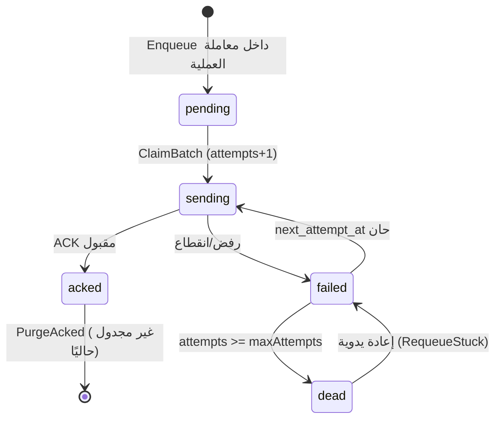

# بروتوكول المزامنة — RS Sales

**الحالة:** **العميل والخادم منفّذان ومُختبَران** (Push/Pull/idempotency/backoff،
تطبيق الأساسيات على الأصناف/العملاء، ومخزن خادم دائم في MariaDB).
**آخر تحقق:** 2026-11-02 — 56/56 اختبارًا ناجحًا.
**ذوو الصلة:** `docs/ARCHITECTURE.md` §4.4 و§9، `docs/BRANCH_MODEL_PROPOSAL.md`.

> ⚠️ **فرق جوهري عن المقترح:** المقترح في `BRANCH_MODEL_PROPOSAL.md` §6 يصف
> ظرفًا أغنى (`schema_version`, `occurred_at`, `business_date`,
> `payload_sha256`, `prev_event_id`) وتوقيع HMAC. **الكود لا يرسل أيًا من
> هذه الحقول.** أي خادم يُبنى على المقترح حرفيًا سيرفض رسائل العميل الحالي.
> القسم 3 أدناه هو العقد الملزم، والقسم 9 يوضّح الفروق الواجب حسمها.

---

## 1. النطاق

| العنصر | الحالة |
|---|---|
| تخزين الأحداث محليًا (outbox) | ✅ منفّذ |
| إرسال دفعات (Push) | ✅ منفّذ |
| استقبال إقرارات لكل حدث | ✅ منفّذ |
| إعادة محاولة بتباعد أسّي | ✅ منفّذ |
| استقبال تغييرات الأساسيات (Pull) | ✅ منفّذ ويُطبّق على الأصناف/العملاء مع idempotency والحذف والرفض |
| وكيل خلفي دوري (Windows Service) | ❌ غير منفّذ — التشغيل يدوي من الشاشة |
| خادم/API مركزي | ✅ منفّذ (MariaDB دائم، تصديق Bearer، fail-closed، استبعاد فرع المصدر) |
| مصادقة جهاز مُهشَّرة وقابلة للإبطال | ❌ غير منفّذ |

**النموذج:** «محلي أولًا + مركز تجميعي». كل فرع يملك قاعدة كاملة ويعمل بلا
إنترنت؛ المركز يستقبل الأحداث ويبني الصورة المجمّعة. جهاز الكاشير لا يتصل
بالمركز مباشرة في المستوى B، بل بخادم الفرع.

---

## 2. دورة حياة الحدث



1. **الكتابة الذرّية:** عملية البيع/الشراء/التسوية/التحويل تكتب صف
   `sync_outbox` داخل **نفس معاملة** العملية. إن فشلت العملية لا يوجد حدث،
   وإن نجحت فالحدث موجود حتمًا.
2. **المطالبة:** `ClaimBatch` يحوّل حتى `limit` صفًا من `pending/failed` إلى
   `sending` ويزيد `attempts` بمقدار 1، بترتيب `occurred_at, event_id`.
3. **الإرسال:** تُبنى دفعة وتُرسل عبر `ISyncTransport` (HTTP في الإنتاج).
4. **الإقرار:** لكل حدث نتيجة مستقلة. المقبول ⇒ `acked` + `acked_at`؛ غير
   المقبول ⇒ `failed` + `last_error` + `next_attempt_at`، أو `dead` عند
   تجاوز الحد.
5. **عدم الحذف قبل الإقرار:** لا يوجد أي مسار يحذف صفًا غير مؤكد. التنظيف
   (`PurgeAcked`) موجود كدالة لكنه **غير مجدول**.

**الذرّية على مستوى الدفعة:** الدفعة **ليست** ذرّية. كل حدث يُعالج ويُسجَّل
على حدة، حتى لا يعيد الفرع إرسال ما نجح.

---

## 3. العقد الفعلي (مطابق لـ `SyncContracts.vb`)

### 3.1 الطلب — `POST {ServerUrl}/api/v1/sync/push`

```http
POST /api/v1/sync/push HTTP/1.1
Content-Type: application/json; charset=utf-8
Accept: application/json
Authorization: Bearer <DeviceKey>

{
  "device_id": 12,
  "events": [
    {
      "event_id": "0199f3a2-7c41-7c3a-9d5e-1a2b3c4d5e6f",
      "branch_id": 3,
      "entity_type": "invoice",
      "entity_id": "1042",
      "event_type": "sale.posted",
      "attempts": 1,
      "payload": "{\"InvoiceId\":1042,\"InvoiceNo\":\"MAIN-S-2026-000042\",\"Total\":228.00,...}"
    }
  ]
}
```

**ملاحظات ملزمة لمن يبني الخادم:**

- `payload` **سلسلة JSON مُشفَّرة مرتين** (كائن داخل نص داخل JSON). يجب
  فكّها مرة إضافية قبل قراءتها.
- `branch_id` موجود في كل حدث، و`device_id` مرة واحدة على مستوى الدفعة.
- `attempts` هو رقم المحاولة **بعد** الزيادة (أول محاولة = 1).
- لا يوجد `schema_version` ولا `occurred_at` ولا `business_date` ولا توقيع —
  راجع §9.
- الحجم: `SyncBatchSize` الافتراضي **50** حدثًا لكل دفعة.

### 3.2 الاستجابة

```json
{
  "accepted": false,
  "results": [
    { "event_id": "0199f3a2-…", "status": "acked",    "error": null },
    { "event_id": "0199f3a2-…", "status": "rejected", "error": "unknown item 77" }
  ],
  "server_time": "2026-10-30T18:30:00Z"
}
```

**قواعد معالجة العميل (منفّذة):**

| الحالة المستقبلة | معنى العميل لها |
|---|---|
| `acked`, `accepted`, `ok`, `duplicate`, `applied` | نجاح ⇒ `acked` |
| أي قيمة أخرى | فشل ⇒ `failed` مع `error` أو `"rejected by server"` |
| `accepted=true` بلا `results` | نجاح **لكل** أحداث الدفعة غير المذكورة |
| حدث في الدفعة بلا نتيجة | فشل `"no acknowledgement for event"` |
| استثناء نقل (شبكة/HTTP غير 2xx) | فشل الدفعة بالكامل مع الرسالة |

`HTTP` غير الناجح يرمي `HttpRequestException` في العميل؛ لذا **يجب** أن يعيد
الخادم `200` مع `results` لكل حدث حتى لو رُفض بعضها. `4xx/5xx` تُفسَّر كفشل
نقل وتُعيد المحاولة.

### 3.3 السحب — `GET /api/v1/sync/pull?stream=master_data&after={seq}&limit={n}&branch={branch_id}`

```json
{
  "changes": [
    { "seq": 51, "entity_type": "item", "entity_id": "77", "op": "upsert",
      "payload": "{\"code\":\"A-001\",\"sale_price\":114.00}" }
  ],
  "next_seq": 51
}
```

- `stream` الحالي الوحيد: **`master_data`**.
- المؤشر محفوظ في `sync_cursors(branch_id, stream, last_seq)`.
- عند عدم وجود تغييرات: `PullOnce` يعيد `0` **ولا يحرّك المؤشر**.
- معرّف inbox synthetic: `pull:{entity_type}:{entity_id}:{seq}` ⇒ تكرار نفس
  التغيير لا يُطبَّق مرتين.
- **التطبيق الفعلي:** `upsert` يطابق الأصناف/العملاء بـ`id` ويحدّث الحقول
  (الاسم، الأسعار، الوحدة، التصنيف الضريبي...)، و`delete` ينفّذ soft delete
  (`is_active=0`) للأصناف والعملاء.
- إن تعذّر تطبيق تغيير (حمولة ناقصة/معرّف غير صالح) يُسجَّل في `sync_inbox`
  بحالة `rejected` مع نص الخطأ، **ويتقدم المؤشر** حتى لا يعلق التيار.

---

## 4. أنواع الأحداث المُصدَرة فعليًا

| `entity_type` | `event_type` | `entity_id` | مصدره | محتوى `payload` |
|---|---|---|---|---|
| `invoice` | `sale.posted` | `invoice_id` | `SalesService.PostSale` | `InvoiceResult` كاملًا |
| `invoice` | `sale_return.posted` | `invoice_id` | `SalesService.PostSaleReturn` | `InvoiceResult` (بقيم سالبة) |
| `invoice` | `purchase.posted` | `invoice_id` | `PurchaseService.PostPurchase` | `InvoiceResult` |
| `invoice` | `purchase_return.posted` | `invoice_id` | `PurchaseService.PostPurchaseReturn` | `InvoiceResult` |
| `invoice` | `opening.posted` | `invoice_id` | `PurchaseService.PostOpeningStock` | `InvoiceResult` |
| `stock_adjustment` | `stock.adjusted` | `item_id` | `StockService.Adjust` | `{branch_id,item_id,qty_delta,unit_cost,reason}` |
| `stock_transfer` | `transfer.sent` | `transfer_id` | `StockService.SendTransfer` | `{id,transfer_no,from_branch,to_branch,lines[]}` |
| `stock_transfer` | `transfer.received` | `transfer_id` | `StockService.ReceiveTransfer` | `{id,transfer_no}` |

**`InvoiceResult`** (نفس الشكل في كل أحداث الفواتير):
`InvoiceId`, `InvoiceNo`, `EventId`, `Subtotal`, `LineDiscount`,
`HeaderDiscount`, `TaxBaseTotal`, `TaxTotal`, `Total`, `Paid`, `Due`,
`QrPayload`, `Lines[]` (كل بند: `LineId`, `ItemId`, `Qty`, `UnitPrice`,
`Discount`, `TaxRate`, `TaxBase`, `TaxAmount`, `LineTotal`, `CostAtSale`).

**استثناء مهم:** تعديل **الأصناف** و**العملاء** لا يُضاف إلى `sync_outbox`؛
يُكتب فقط في `change_log` المحلي عبر `SyncStore.AppendChange`. أي أن هذه
التغييرات **لا تُرفع للمركز بالـ Push الحالي**. هذا فرق وظيفي يجب حسمه
(إما إضافتها كأحداث `item.upsert` / `customer.upsert`، أو اعتبار المركز
المصدر الوحيد لها كما يقترح نموذج الفروع).

---

## 5. الحالة المحلية والجداول

### 5.1 `sync_outbox`

| العمود | الوظيفة |
|---|---|
| `event_id` (PK) | معرّف UUIDv7 فريد؛ أساس الـ idempotency |
| `branch_id`, `device_id` | نطاق الحدث |
| `entity_type`, `entity_id`, `event_type` | التوجيه |
| `aggregate_version` | يُخزَّن (حاليًا دائمًا 1) ولا يُرسَل |
| `payload` | JSON نصي |
| `occurred_at` | UTC؛ ترتيب المطالبة ومهلة إعادة الصفوف العالقة |
| `status` | `pending` / `sending` / `acked` / `failed` / `dead` |
| `attempts` | يزيد عند كل مطالبة |
| `next_attempt_at` | بوابة إعادة المحاولة |
| `last_error`, `sent_at`, `acked_at` | تشخيص |

- `Enqueue` يستخدم `ON DUPLICATE KEY UPDATE payload=VALUES(payload)` — إعادة
  الإضافة بنفس المعرّف **لا تُعيد ضبط الحالة** (حدث مؤكد يبقى مؤكدًا).
- `ClaimBatch` تحديث بـ `LIMIT` ثم `SELECT status='sending'` — **يفترض عامل
  مزامنة واحدًا لكل فرع**. تشغيل عمليتين متزامنتين قد يقرأ كلٌّ منهما صفوف
  الأخرى. (دين تقني موثّق، لا يُنصح بتشغيل أكثر من عامل.)

### 5.2 `sync_inbox`

`event_id` مفتاح أساسي، و`INSERT ... ON DUPLICATE KEY UPDATE event_id=event_id`
⇒ التكرار لا يُطبَّق ويُعاد `duplicate`. يُخزَّن `result`, `error`,
`applied_at`، و`branch_id`.

### 5.3 `sync_cursors`

`(branch_id, stream)` ← `last_seq`، مع `GREATEST(last_seq, VALUES(last_seq))`
لمنع التراجع.

### 5.4 `change_log`

`seq` تلقائي، `entity_type`, `entity_id`, `op`, `payload`, `branch_id`,
`changed_at`. يُستخدم لبناء تدفق `master_data` للسحب. **يُكتب محليًا في
الفرع**؛ لا يوجد كود يرسله للمركز.

---

## 6. إعادة المحاولة

```
المحاولة:  1     2     3     4     5     6     7      8      9      10
التأخير:  10s   20s   40s   80s  160s  320s  640s  1280s  2560s  → dead
```

- الصيغة المنفّذة: `min(3600, 10 × 2^(attempts-1))` ثانية، حيث `attempts`
  بعد الزيادة.
- `maxAttempts` من `AppConfig.SyncMaxAttempts` (افتراضي **10**).
- عند بلوغ الحد: `status='dead'` مع `last_error`؛ لا حذف ولا إسقاط صامت.
- إعادة يدوية: زر «إعادة المحاولة» في `SyncForm` ينقل الصفوف العالقة إلى
  `failed` مع `next_attempt_at=now`.
- **ملاحظة تصميمية:** `RequeueStuck` يعتمد على `occurred_at` وليس على وقت
  المطالبة؛ لذلك حدث أُنشئ قبل دقائق ثم تعطّل العامل أثناء إرساله لا يُستعاد
  إلا بعد مرور المهلة من وقت حدوثه. الحل الأنسب: عمود `claimed_at`.

---

## 7. الترتيب والساعة

- `occurred_at` UTC في قاعدة الفرع، و`business_date` بتوقيت الفرع.
- ترتيب المطالبة: `occurred_at, event_id` (قابل للفرز زمنيًا بفضل UUIDv7).
- **لا يوجد ترتيب مضمون لكل كيان على حدة** في العقد الحالي؛ `aggregate_version`
  موجود في outbox لكنه غير مُرسَل وغير مُتحقَّق منه في المركز.
- **لا تحقق من انحراف الساعة** حاليًا، ولا حقل زمن في الرسالة أصلًا
  (`SyncAck.ServerTime` يُستقبل ولا يُستخدم).

---

## 8. التعارضات — المنفّذ والمخطط

| الحالة | القاعدة | الحالة |
|---|---|---|
| نفس الحدث يصل مرتين | `sync_inbox` PK ⇒ `duplicate` بلا أثر | ✅ منفّذ ومُختبَر |
| فاتورة مُرحّلة تُعدَّل | ممنوع؛ `invoices` غير قابلة للتعديل، التصحيح بوثيقة جديدة | ✅ منفّذ |
| بيع يتجاوز الرصيد | مرفوض محليًا داخل المعاملة (D-09) | ✅ منفّذ ومُختبَر |
| تحويل بين فرعين | مرحلتان `sent` → `received`، ولا يزيد رصيد المستلم قبل الاستلام | ✅ منفّذ ومُختبَر |
| فشل اتصال أثناء دفعة | لا فقدان؛ `failed` + backoff | ✅ منفّذ ومُختبَر |
| فرعان يعدّلان نفس الصنف | المركز يفوز، وتعديل الفرع يتحول لطلب تغيير | ❌ مخطط |
| عميل أُنشئ مرتين offline | الاحتفاظ بالـ UUIDين + دمج يدوي | ❌ مخطط |
| ساعة منحرفة > 10 دقائق | رفض/تحذير | ❌ مخطط |
| تحويل أُرسل ولم يُستلم | يظهر «في الطريق» | 🟡 الحالة موجودة، لا تقرير معلّق |
| استرجاع فرع من لقطة | استئناف المسلسل بلا تصادم | ❌ مخطط (مرحلة 7) |

**المبدأ الحاكم:** لا دمج حقول ماليًا، ولا `last-write-wins`، ولا تطبيق جزئي
لحدث. التصحيح دائمًا بوثيقة جديدة.

---

## 9. الفروق بين المقترح والمنفّذ (يجب حسمها قبل بناء الخادم)

| الحقل/القاعدة في المقترح | في الكود | التوصية |
|---|---|---|
| `schema_version` | غائب | **أضِفه إلزاميًا** الآن قبل أن يوجد عملاء في الميدان |
| `occurred_at`, `business_date` | غائبان من الرسالة | أضفهما؛ بدونهما لا يمكن كشف انحراف الساعة أو ترتيب الأحداث |
| `payload_sha256` | غائب | أضفه للتحقق من سلامة الحمولة |
| `prev_event_id` / `aggregate_version` | `aggregate_version` مخزّن فقط | أرسِله وتحقّق منه لكل كيان |
| توقيع HMAC + nonce + طابع زمني | غائب | مطلوب لمنع إعادة الإرسال |
| توكن جهاز مُهشَّر وقابل للإبطال | `DeviceKey` نصي في الإعدادات، ومحمي بـ DPAPI على العميل | هشّره في المركز واربطه بجهاز |
| TLS 1.2+ إلزامي | **مفروض** في `HttpSyncTransport` خارج localhost | أبقِه وأضف تثبيت شهادة إن لزم |
| دفعات ≤ 200 حدث / 1MB | 50 حدثًا، بلا حد حجم | أضف حد حجم في العميل والخادم |
| وكيل كل 60 ثانية | تشغيل يدوي فقط | خدمة خلفية أو مؤقت داخل التطبيق |
| `change_log` يُرفع للمركز | محلي فقط | احسم ملكية الأساسيات (المركز مقابل الفرع) |

---

## 10. الخادم المركزي المنفّذ

### 10.1 `POST /api/v1/sync/push`

1. البرمجية الوسيطة تتحقق من `Authorization: Bearer` بمقارنة ثابتة الزمن.
   المزامنة معطّلة افتراضيًا، وتفعيلها بلا `Sync:ApiToken` أو
   `Sync:ConnectionString` يمنع إقلاع الخادم (fail-closed).
2. يتحقق الخادم من الحقول الإلزامية والأطوال وحجم الحمولة (حتى 1,000,000 حرف).
3. لكل حدث **داخل معاملة مستقلة**:
   - `INSERT IGNORE` في `server_sync_events` بمفتاح `event_id` ⇒ إن لم يُدرج
     فالصف موجود مسبقًا وتكون النتيجة `duplicate` بلا أثر.
   - أحداث `item`/`customer` تُضاف إلى `server_change_log` مع
     `origin_branch_id`؛ `item.deleted`/`*.removed` تُسجَّل كـ`delete`.
   - الأحداث غير الصالحة تُرفض بـ`rejected` + سبب، ولا تُكتب.
4. الاستجابة دائمًا `HTTP 200` مع `results` لكل حدث و`server_time`.
5. `MaxEventsPerBatch = 500`.

### 10.2 `GET /api/v1/sync/pull?stream=master_data&after={seq}&limit={n}&branch={id}`

- يقرأ من `server_change_log` حيث `seq > after` بحد أقصى `limit` (1–500).
- يستبعد `origin_branch_id = branch` كي لا يستقبل الفرع تغييراته.
- يعيد `changes` و`next_seq` = آخر `seq` أُرسل، أو `after` إن لا تغييرات.
- يرفض `stream` غير `master_data` أو `branch <= 0` بـ`400`.

### 10.3 جداول المركز (هجرة `V009__sync_server.sql`)

| الجدول | الغرض |
|---|---|
| `server_sync_events` | سجل دائم لكل `event_id` مع النتيجة والخطأ (مفتاح idempotency) |
| `server_change_log` | تيار الأساسيات الذي تسحبه الفروع مع `origin_branch_id` |

**ما زال مطلوبًا قبل الإنتاج:** ربط التوكن بجهاز/فرع محدد بدل توكن مشترك،
هاش التوكن في قاعدة المركز، حد معدل، وتطبيق أحداث الفواتير/المخزون في المركز
(حاليًا تُخزَّن الأحداث لكن لا يُبنى منها رصيد مركزي).

---

## 11. الأمان

| المتطلب | الحالة |
|---|---|
| Bearer DeviceKey | ✅ يُرسَل ويُتحقَّق منه بمقارنة ثابتة الزمن |
| TLS إلزامي | ✅ `HttpSyncTransport` يرفض `http` خارج localhost |
| تحقق شهادة صالح | ✅ افتراضي في `HttpClient` بلا تجاوز |
| توكن مُهشَّر في المركز | ❌ مقارنة بتوكن الإعداد (مشترك) |
| HMAC + nonce + طابع زمني | ❌ غير منفّذ |
| حد معدل لكل فرع | ❌ غير منفّذ |
| تخزين التوكن آمنًا (DPAPI) | ✅ على العميل عبر `CredentialStore` |
| عدم تسجيل الأسرار | ✅ لا يُسجَّل التوكن في `AppLog` |

**قبل أي نشر:** اربط كل جهاز بتوكن خاص مُهشَّر في المركز، وأضف حد معدل،
و`schema_version` + توقيع للحمولة.

---

## 12. الاختبارات الحالية

| الاختبار | ما يثبته |
|---|---|
| `OutboxIsIdempotentAndKeepsFailedEvents` | إضافة مكررة ⇒ صف واحد؛ فشل ⇒ `dead` عند الحد؛ `PurgeAcked` لا يمس الفاشل |
| `SyncPushAcksAcceptedAndRetriesRejectedEvents` | إقرار لكل حدث؛ المرفوض `failed` ثم يُقبل بعد توفر المحاولة (ببديل `ISyncTransport` وهمي) |
| `SyncFailureDoesNotDropEvents` | انقطاع النقل لا يحذف الحدث ويحوّله `failed` |
| `SyncPullAppliesItemAndCustomerIdempotently` | تطبيق صنف وعميل؛ إعادة السحب لا تطبق مرتين |
| `SyncPullDeleteDisablesRecord` | `op=delete` يعطّل السجل (`is_active=0`) |
| `SyncPullRejectsBadPayloadAndAdvancesCursor` | حمولة سيئة ⇒ `rejected` مع تقديم المؤشر |
| `PushIsIdempotentAndPublishesMasterData` | الخادم: `acked` ثم `duplicate`، ونشر التغيير لفرع آخر فقط |
| `PushRejectsInvalidEventWithoutWriting` | حدث غير صالح لا يُكتب |
| `DeleteEventIsPublishedAsDelete` | `item.deleted` تُنشر كـ`delete` |
| `SalePostsInvoiceStockJournalTaxAndOutbox` | الحدث يُكتب داخل معاملة البيع بحالة `pending` |

**غير مُختبَر:** اتصال HTTP حقيقي بين عميل وخادم، تعارض فرعين، انحراف ساعة،
إعادة تشغيل وسط الإرسال، تشغيل عاملين متزامنين، أحجام دفعات كبيرة.

---

## 13. اختبارات القبول للمرحلة 5 (من المقترح)

- [ ] 100 فاتورة offline ثم عودة الشبكة ⇒ 100 حدث، صفر تكرار، مطابقة إجماليات.
- [ ] قطع الشبكة وسط دفعة ⇒ لا تطبيق جزئي، وإعادة المحاولة تكمل.
- [ ] إعادة إرسال نفس الحدث 10 مرات ⇒ أثر واحد.
- [ ] فرعان يبيعان نفس الصنف ⇒ رصيد المركز = مجموع الحركتين.
- [ ] تحويل مُرسل بلا استلام ⇒ لا يزيد رصيد المستلم.
- [ ] استرجاع فرع من لقطة ⇒ المسلسل يكمل بلا تصادم.
- [ ] ساعة فرع متقدمة ساعة ⇒ مزامنة مرفوضة/محذرة.
- [ ] مستخدم فرع لا يرى بيانات فرع آخر (عزل).
- [ ] إعادة تشغيل خادم الفرع ⇒ لا فاتورة مفقودة.

الحالة الآن: البنود الثانية والثالثة مغطّاة على مستوى الوحدة، والسحب والخادم
الدائم مغطّيان باختبارات تكامل؛ الباقي يحتاج بيئتين حقيقيتين وربطًا فعليًا بين
العميل والخادم.

---

## 14. أسئلة مفتوحة للمالك

| # | السؤال | يحدد |
|---|---|---|
| B-01 | أين المركز: المقر أم VPS؟ | عنوان `ServerUrl` وشهادة TLS |
| B-02 | عدد الفروع الآن وبعد سنتين؟ | حدود الدفعات والتحميل |
| B-03 | جودة الإنترنت في الفروع؟ | مهلة/تكرار المزامنة |
| B-04 | جهاز خادم فرع أم جهاز واحد؟ | مستوى A أو B |
| B-05 | من يملك الأصناف والأسعار؟ | اتجاه تدفق `master_data` |
| B-06 | هل يُسمح بتعديل سعر محلي؟ | سياسة التعارض |
| B-07 | كل الفروع في نفس التوقيت؟ | تعريف `business_date` |
| B-08 | مالك واحد يرى كل الفروع من جهاز واحد؟ | تقارير المركز |

---

## 15. المراجع

- `src/RsSales.Sync/SyncContracts.vb` — عقد السلك.
- `src/RsSales.Sync/SyncService.vb` — التنسيق وإعادة المحاولة.
- `src/RsSales.Sync/HttpSyncTransport.vb` — نقاط النهاية والرؤوس.
- `src/RsSales.Data/SyncStore.vb` — outbox/inbox/cursors/change_log.
- `src/RsSales.UI/SyncForm.vb` — التشغيل اليدوي وعرض الحالة.
- `docs/BRANCH_MODEL_PROPOSAL.md` — النموذج وملكية البيانات واختبارات القبول.
